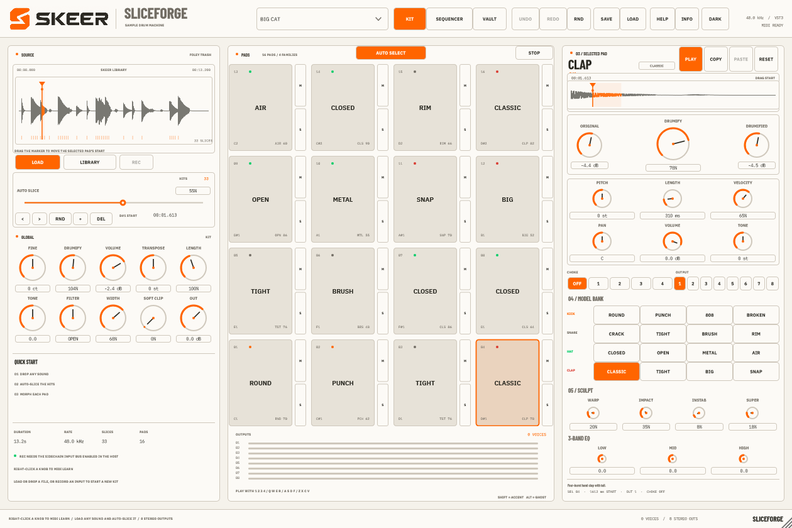
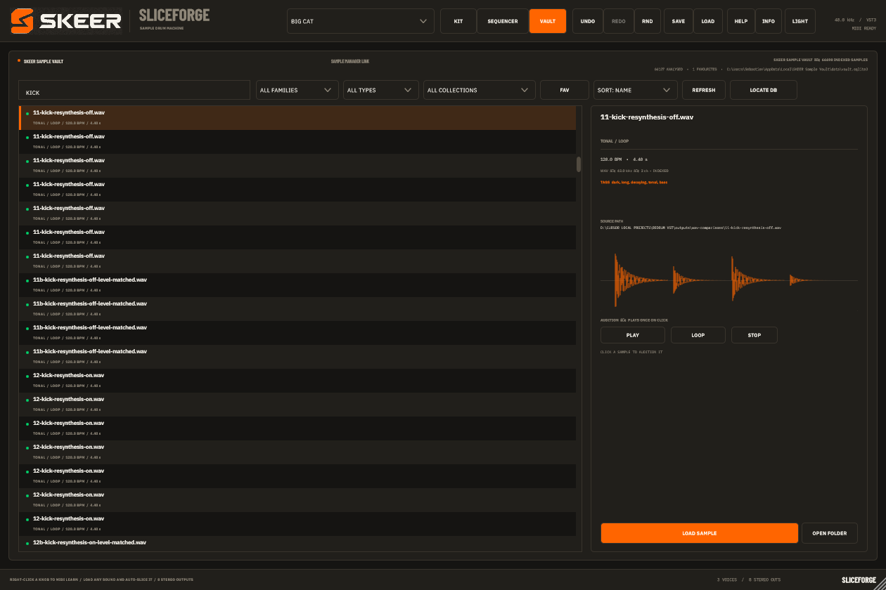
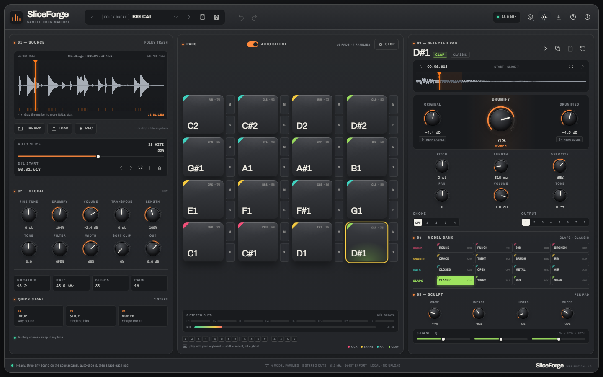

# SKEER SliceForge — Native VST3 & Web Edition

**One sound. One drum kit.**

SKEER SliceForge is a sample-based drum machine that runs as a **native SKEER-branded VST3
instrument / standalone application** and as a browser instrument. Drop any recording, let
the auto-slicer find every hit, and morph each of the sixteen pads between the original audio
and a bank of kick, snare, hat and clap models. Every pad can be shaped with Warp, Impact,
Instability, Tone Shift, Super and a three-band EQ, then performed, mixed and printed.



**Native edition** — SKEER wordmark, IBM Plex / Barlow Condensed typography and the SKEER
warm-ivory/orange studio palette, plus 16 pads, 16 models, 8 stereo outputs, sample-accurate
MIDI, MIDI CC learn, sidechain-input recording, six factory kits, host-saved state with the
custom sample, a host-synced 32-step sequencer with four patterns, probability/ratchet editing,
micro-timing, flams, parameter locks, per-lane polymeter, pattern duplicate, an eight-slot song
chain, pattern presets, MIDI export and extensive randomization, a read-only link to the **SKEER
Sample Vault** library index, light and dark SKEER themes, and a resizable 1260×840 editor. See
[`native/README.md`](native/README.md) for the build, install and test instructions.


**Dark mode** — the DARK / LIGHT header button switches every page, inspector and dialog surface
between the ivory and charcoal skins; the choice is remembered per user.

The sequencer's steps are colour-coded by drum family, while playback uses a dedicated green
playhead and transport indicator.




> Everything runnable lives in [`launch/`](launch) at the repository root: the standalone
> `SliceForge.exe`, the `SliceForge.vst3` bundle and the portable
> [`launch/SliceForge-1.0.0-Windows-x64.zip`](launch/SliceForge-1.0.0-Windows-x64.zip). Double-click
> [`launch/start.bat`](launch/start.bat) to refresh the VST3 install, open the standalone and
> serve the browser edition. The install goes to one place,
> `%ProgramFiles%\Common Files\VST3` — the system folder your DAW already scans — so it asks for
> elevation once, for the copy step only, and removes any older copy left in `Documents\VST3` or
> `%LOCALAPPDATA%\Programs\Common\VST3`.

The browser edition remains fully functional with its original interface styling and is
documented below.

This is an independent, non-commercial interpretation built from the VRAC+ product brief and
interface references. It is not affiliated with Beatsurfing / Druw Audio.


| Dark mode | Factory library |
| --- | --- |
|  |  |

---

## What it does

| Area | Implemented |
| --- | --- |
| **Source** | Drag and drop or browse WAV, AIFF, MP3, FLAC, OGG and M4A; record an input; six factory sound worlds; one shared source sliced into sixteen starts |
| **Slicing** | Transient auto-slicer with sensitivity; previous / next / random slice; add and delete slices; drag any pad's start marker on the waveform |
| **Pads** | 16 chromatic pads (C1–D#2), per-pad mute and solo, velocity-sensitive triggering, click-position velocity, keyboard and MIDI input |
| **Models** | Four families × four models = 16 drum models; each pad has its own morphology blend between the original sample and the selected model |
| **Per-pad design** | Drumify blend, independent Original/Drumified levels, Pitch, Length, Volume, Pan, Velocity amount, Choke groups, Output bus, Warp, Impact, Instability, Tone Shift, Super and 3-band EQ |
| **Global** | Fine tune, global Drumify macro, master volume, transpose, length scale, tone, DJ-style filter, stereo width, plus the output stage: soft clip and OUT trim |
| **Performance** | Auto-select, choke groups, 32-voice engine, eight stereo output buses and live bus/master meters |
| **Presets** | Six factory kits, local saved kits, JSON import/export, per-kit undo/redo |
| **MIDI** | Note triggering (C1–D#2 = MIDI 36–51) with velocity; Web MIDI learn on every knob; mappings saved locally |
| **Export** | 24-bit / 48 kHz WAV for the selected pad, or a ZIP of all sixteen pads with a manifest and README |
| **Extras** | Light and dark themes, sample persistence in IndexedDB, copy/paste pad settings, randomiser, responsive layout and a built-in user guide |

The factory library is not a copy of the commercial VRAC+ library. It is six original
procedural found-sound worlds — foley, kitchen percussion, body music, scrap metal, circuit
noise and vinyl dust — generated deterministically in the browser so the project ships with
no audio downloads. The real library was produced with foley artist Olivier Thys; this web
edition is a tribute built from its own recipes.

---

## Quick start

Requirements: Node.js 20.19+ (or 22.12+), npm, and a browser with the Web Audio API and
AudioWorklet. Chrome or Edge is recommended.

```powershell
npm install
npm run dev
```

Open **http://127.0.0.1:5173/**. Click a pad or the audio status button to wake the audio
engine (browsers require a user gesture). Everything is processed locally; no audio is
uploaded.

Production build:

```powershell
npm run build
npm run preview
```

The app is a static Vite bundle in `dist/`. Serve it from the site root because the
AudioWorklet module is loaded from `/sliceforge-worklet.js`.

---

## Playing it

- **Pads** — click a pad; click near the bottom for a softer hit, near the top for a harder
  one. Hold **Shift** for a full-velocity accent, **Alt** for a ghost.
- **Computer keyboard** — the grid maps to `1 2 3 4 / Q W E R / A S D F / Z X C V`.
- **Auto select** — when on, keyboard and MIDI notes move the selection to the pad they play.
- **Slices** — `[` and `]` step the selected pad through detected slices; `T` lands on a
  random one. The waveform marker can be dragged directly.
- **Stop** — `Space` (or the STOP button) cuts all voices.
- **Undo / redo** — `Ctrl/Cmd+Z` and `Ctrl/Cmd+Shift+Z` (or `Ctrl+Y`).
- **Empty a kit** — right-click any knob to MIDI-learn it; double-click to reset it.

A selected pad is outlined in yellow. The right-hand editor shows the selected pad's family
colour, model and every control; the source panel on the left owns the sample, slice
sensitivity and global controls.

The built-in guide covers the workflow, controls and full shortcut list:


---

## MIDI

1. Open the MIDI dialog from the header and click **ENABLE MIDI**.
2. Pads answer notes **C1–D#2 (MIDI 36–51)** with velocity.
3. Right-click any learnable knob, then move a controller. The CC is mapped and stored in
   `localStorage`; the next CC movement drives the parameter. Right-click again to relearn.
4. Map/list/remove all assignments in the MIDI dialog.

Web MIDI is exposed over HTTPS and `localhost`. If your browser does not support it, the
dialog says so and the rest of the instrument still works.

---

## Export

The export dialog renders one-shots through the same voice engine and master chain you hear:

- **Selected pad** — one 24-bit / 48 kHz stereo WAV.
- **Full kit** — ZIP containing 16 named WAVs (`D1_SNARE_2.wav`), `kit.json` with the full
  parameter state, and a short README. Files include the stereo output bus in their names.

Rendering uses a pure-JS one-shot engine, then the master chain — including the soft clipper and
OUT trim — is applied through an `OfflineAudioContext`, so an exported WAV leaves the same way the
live output does. The browser tab must stay awake while the ZIP is prepared.

---

## How it is built

```
src/
  App.tsx                  instrument shell, keyboard/MIDI wiring, modals, toasts
  types.ts                 shared state, factory model bank, ranges and formatting
  audio/
    engineCore.ts          polyphonic voices, model synthesis, sample morph, 8 buses
    worklet.ts             AudioWorkletProcessor wrapper (bundled to public/sliceforge-worklet.js)
    audioEngine.ts         main-thread AudioContext, worklet, master chain, meters
    masterChain.ts         global filter/tone/compressor/limiter/volume + output stage
    outputStage.ts         soft clipper → OUT gain → ±0.999 ceiling (same math as native Dsp.h)
    sampleLibrary.ts       six deterministic procedural sources and peak data
    slicer.ts              RMS-flux onset detector, slice ownership and remapping
    exportKit.ts           offline one-shot render, WAV/ZIP export, kit manifest
    wav.ts / zip.ts        dependency-free encoders
    midi.ts                Web MIDI access, notes, CC learn
    dsp.ts / rng.ts        biquads, envelopes, pan law, seeded noise
  state/
    useKit.ts              reducer with undo/redo history and all kit actions
    factoryPresets.ts      six factory kits built on the shared model bank
    randomize.ts           role-aware random kit generator
    storage.ts             local presets, theme and MIDI mappings
    sampleStore.ts         IndexedDB persistence for user samples
  components/              header, source panel, pad grid, pad editor, controls, modals
  css/                     layout, panels, dialogs, responsive rules
scripts/
  build-worklet.mjs        esbuild bundle for the AudioWorklet entry
  e2e.mjs                  browser end-to-end smoke test (fake MIDI + fake mic)
  screenshots.mjs          regenerate the documentation screenshots
```

### Audio path

```
sample layer ─┐
              ├─ tone/EQ ─ warp ─ saturation ─ width ─ pan ─ bus 1..8 ─┐
model layer ──┘                                                        │
                                                                       master
                         ┌─────────────────────────────────────────────┘
                         └─ filter ─ tone shelves ─ compressor ─ limiter ─ volume
                                       ─ soft clip ─ OUT gain ─ ceiling ─ out
```

- **One AudioWorklet** renders up to 32 voices and eight stereo buses. Each voice owns its
  sample read head, model state and biquad filters. The worklet is bundled with esbuild so
  it can stay a fast, dependency-free AudioWorklet module.
- **The model bank is synthesised**, not sampled. Kicks use pitch-enveloped bodies, snares
  combine filtered noise with two body tones, hats mix a metallic wavetable with high-passed
  noise, and claps use multi-burst noise envelopes. The UI model names and character
  descriptions map to these recipes.
- **Drumify is an equal-power morph** between the sample layer and the model layer, with
  independent gain for each layer. At 0% you hear only the original; at 100% only the model.
- **The sample and model stay in one voice**, so a pad's envelope, transient shaping, warping,
  EQ, saturation, pan and bus routing apply to the whole hit rather than to two unrelated
  sounds.
- **No audio thread allocations** happen per voice trigger: the voice pool and filters are
  allocated up front.
- **The output stage is one curve.** `SOFT CLIP` (0–100 %) moves a tanh knee from 0.999 down to
  0.349, `OUT` (−24 to +12 dB) trims afterwards, and a hard ±0.999 ceiling always gets the last
  word. At 0 % the curve is the identity, so the stage is bit-exact and never attenuates anything
  below the knee. Because a `WaveShaperNode` curve cannot be automated, the whole stage is baked
  into one Float32Array and swapped only when the two values change — the same maths as
  `sliceforge::OutputStage` in `native/Source/Engine/Dsp.h`. The trim is an explicit knob rather
  than automatic makeup gain, so louder is always a choice you can see.

### Coordinates and state

- The slicer detects onsets on an RMS-slope envelope, then selects the strongest local maxima
  with a minimum spacing. Sensitivity changes the target count. Sliced starts are distributed
  across the sixteen pads; all slice edits go through the reducer's history.
- The reducer holds `{kit, sample, slices}` snapshots. Knob drags push one history entry at
  pointer-down, not one per pixel, so undo returns to where the gesture started. Preset
  loading, randomising, muting and sample swaps all participate in undo.
- State changes are sent to the worklet immediately and again before each trigger, so mute
  and solo take effect on the very next hit.
- Custom samples are written to IndexedDB. Saved kits that use a dropped file can therefore
  restore after a reload without re-importing the audio.

---

## Tests

Unit tests cover the deterministic library, slicer behaviour, WAV/ZIP correctness, offline
one-shot rendering, voice gating, choke groups, the output-stage curve and every model in the
bank (30 tests, 3 files):

```powershell
npm test
```

The browser end-to-end test uses the installed Chrome through `playwright-core` (no browser
download) and fake MIDI/media devices, so it can exercise note input, CC learn, recording,
custom-sample persistence and a full-kit export without hardware:

```powershell
# in one terminal
npm run dev

# in another
npm run test:browser
```

It checks 27 behaviours and exits non-zero on the first failure. To regenerate the
documentation screenshots while the dev server is running:

```powershell
npm run test:screenshots
```

The browser test depends on `fixtures/user-groove.wav`; the ZIP it produces is written to
`test-results/` (ignored by the dev server watcher).

---

## Known limitations

- **It is a web instrument, not a plugin.** It does not load as VST3/AU/AAX, and it cannot
  receive audio from a DAW track the way a plugin does. Recording uses the browser's audio
  input APIs (microphone, interface input or a loopback device).
- **Export is a button, not a drag.** Chrome's file-drag APIs are not reliable enough to drag
  a generated one-shot straight into a DAW, so the ZIP/WAV export path is the supported one.
- **The factory library is synthesised**, not the commercial VRAC+ recordings. It uses six
  procedurally generated found-sound sources and deterministic seeds; the real library's
  Olivier Thys recordings are not included.
- **Tone Shift is a spectral tilt/peak-shift approximation**, not a full phase-vocoder
  frequency shifter. It is intended as a character control, not a laboratory spectrum
  shifter.
- **Browser memory limits apply.** Source files are capped at 10 minutes / 160 MB before
  decoding. Recording is capped at 2 minutes.
- **Saved kits with a custom sample depend on this browser's IndexedDB.** Export the WAVs if
  you need a portable archive; the JSON preset stores the kit parameters and source
  reference, not the audio itself.
- **Web MIDI is browser-dependent.** Chrome/Edge support it well; Firefox does not expose it
  by default; Safari support varies. No MIDI is required to play.
- **The project targets modern evergreen browsers.** It is tested in Chrome. AudioWorklet is
  required; very old browsers will show an audio error.

---

## Design notes

The interface follows the supplied SliceForge references: cool light grey panels, black hardware,
warm pads, coloured family corners and a single orange signal colour. The dark theme is a
night-studio counterpart. Typography uses Archivo / Archivo Narrow for instrument labels and
IBM Plex Mono for values. Controls are built from plain React and CSS without a component
library; the knob arc, pad corners, waveform and meters are drawn in the DOM or canvas.

The instrument is designed to fit a 1440 × 900 window without scrolling, with compact variants
for 1366 × 768 and 1280 × 720, and a stacked layout below 1120 px. All control ranges,
factory presets and model names live in shared modules so the UI and the engine cannot drift
apart.

---

## Credits and disclaimer

This is an independent, non-commercial educational build, created as a response to the VRAC+
product brief and two interface reference images. **VRAC+**, **Beatsurfing**, associated
marketing copy and any original product assets are the property of their respective owners
(Beatsurfing / Druw Audio srl). This project is not affiliated with, endorsed by or distributed
by them. No original commercial sample content is included.

Original product information: [beatsurfing.com/audio-plugins/vrac-plus](https://beatsurfing.com/audio-plugins/vrac-plus/).
