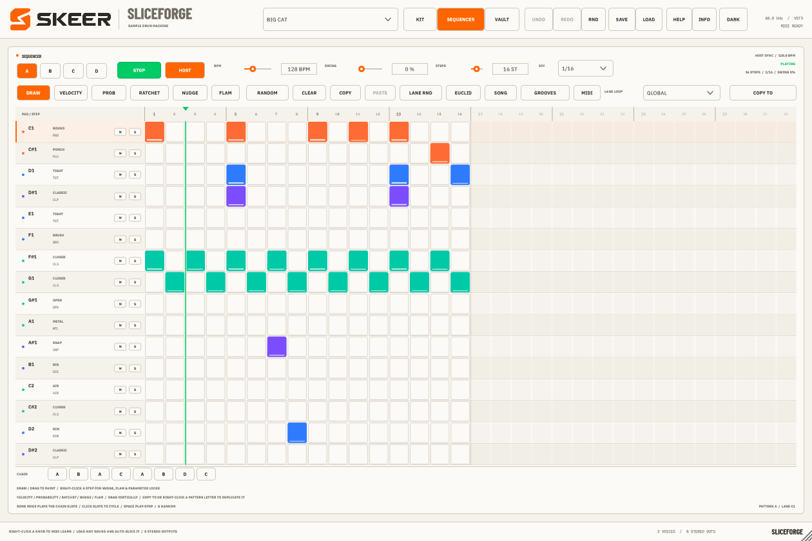
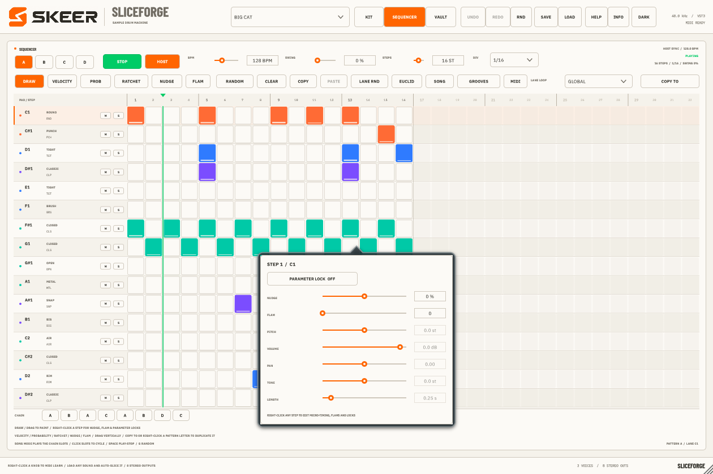
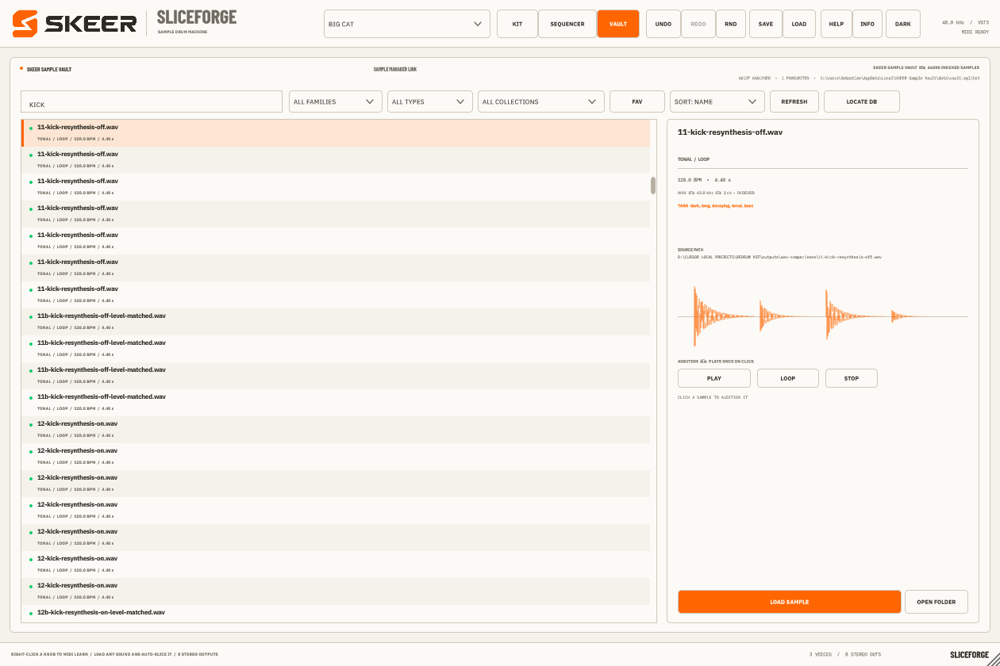
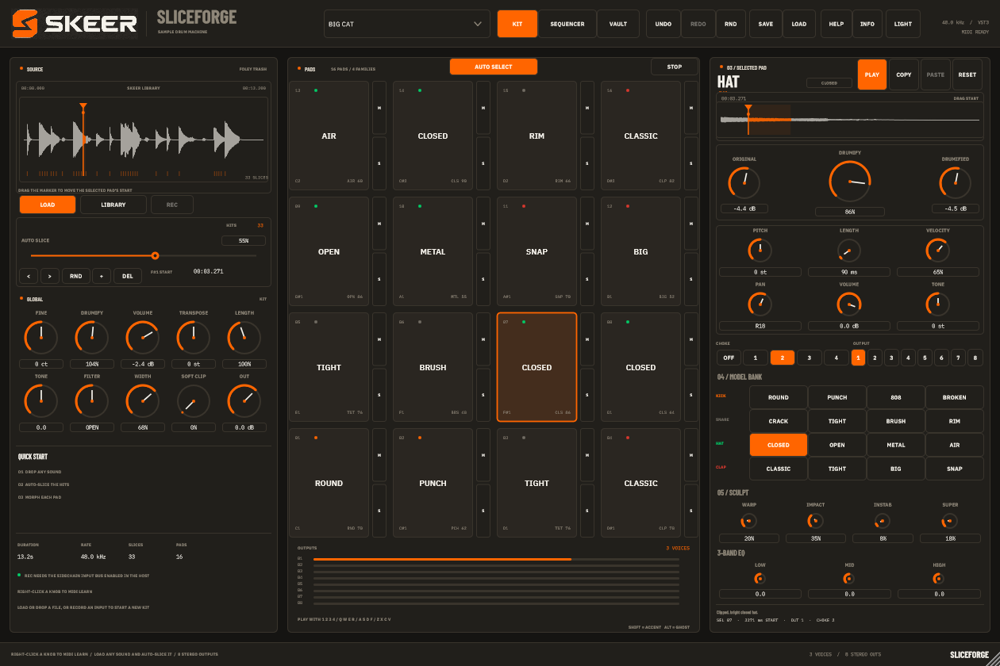
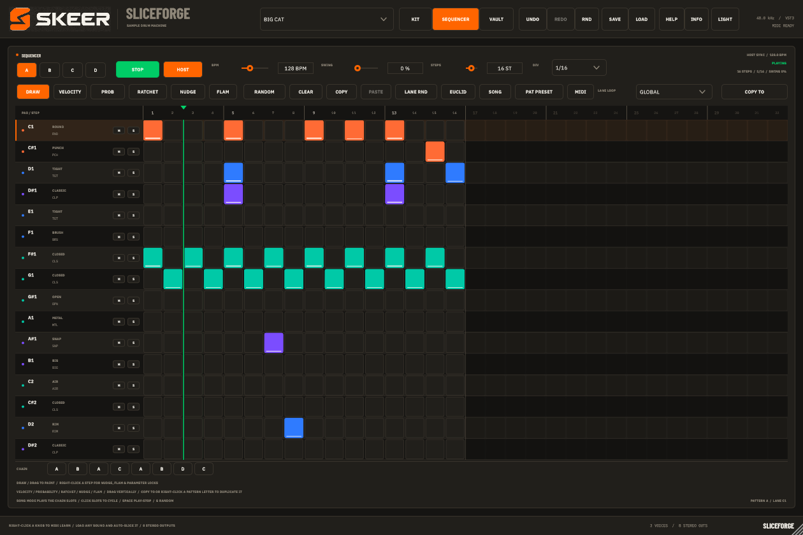
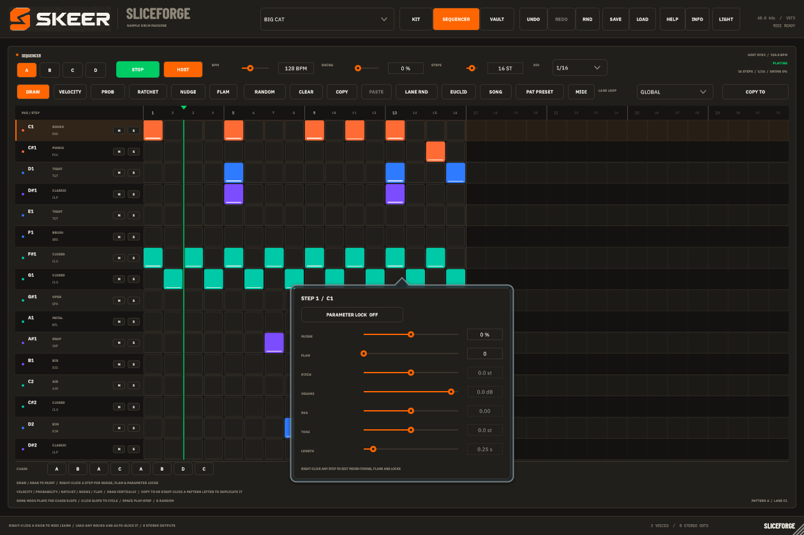
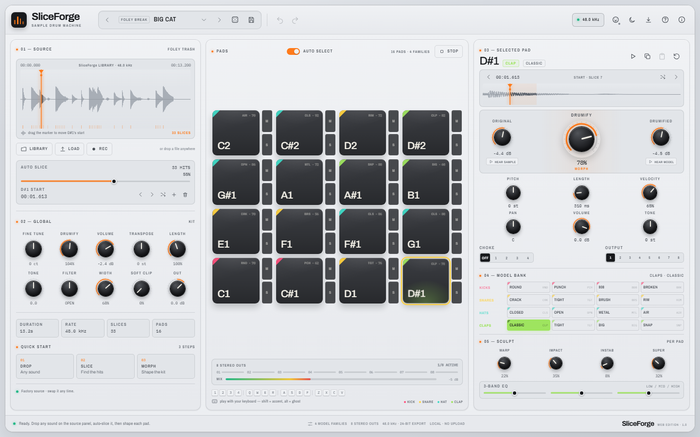
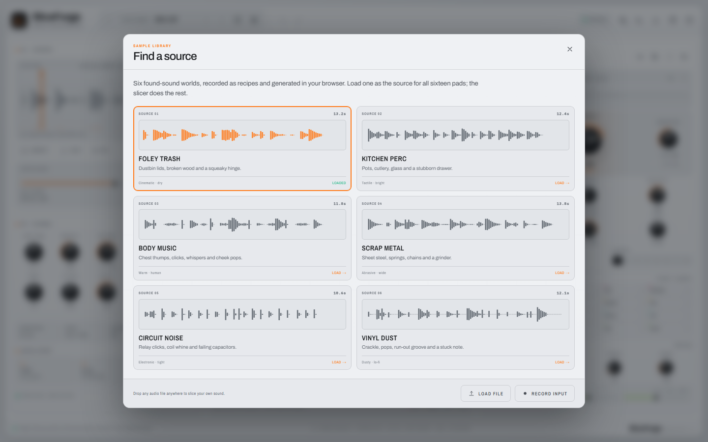
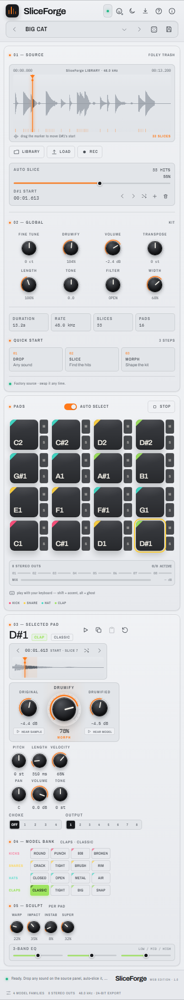
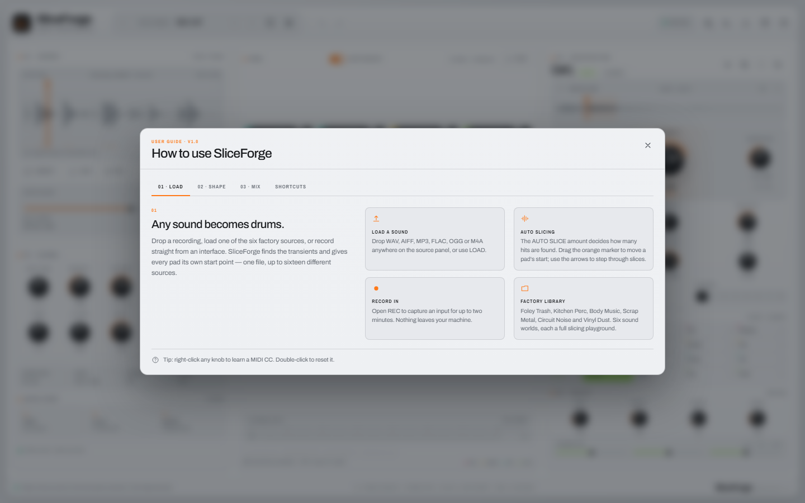

# SKEER SliceForge

**One recording. One playable drum kit.**

SliceForge is a sample-based drum machine that exists as two editions of one engine design: a
**native VST3 instrument and standalone application** (JUCE 8, C++) and a **browser instrument**
(React, Web Audio). Drop in any recording — a foley session, a take off a phone, a break from a
record — the auto-slicer finds every hit and gives each of sixteen pads its own start *and its own
end*, and then you morph each pad between that original audio and a bank of kick, snare, hat and
clap models. Every pad has 21 controls; the engine has 348 of them.


Everything runnable lives in [`launch/`](launch) at the repository root: the standalone
`SliceForge.exe`, the `SliceForge.vst3/` bundle and the portable
[`launch/SliceForge-1.0.0-Windows-x64.zip`](launch/SliceForge-1.0.0-Windows-x64.zip). Double-click
[`launch/start.bat`](launch/start.bat) to refresh the VST3 install, open the standalone and serve
the browser edition. The install goes to one place, `%ProgramFiles%\Common Files\VST3` — the system
folder your DAW already scans — so it asks for elevation once, for the copy step only, and removes
any older copy left in `Documents\VST3` or `%LOCALAPPDATA%\Programs\Common\VST3`.

---

## The two editions

Same engine, same parameter names, same ranges, same defaults, same model bank. They are a C++ and
a TypeScript implementation of one design, so a kit built in either one sounds like the same
instrument. Three surfaces exist only in the native edition, and three only in the web edition.

| | Native VST3 / standalone | Web edition |
| --- | --- | --- |
| Runs in | any VST3 host, or alone as `SliceForge.exe` | Chrome / Edge, offline after load |
| Factory library | six real recordings, compiled into the binary | six procedurally generated worlds, deterministic |
| Recording source | the plug-in's **sidechain input bus** | the browser's audio input (`getUserMedia`) |
| Sequencer | **yes** — 16 lanes × 32 steps, 4 patterns, song chain | no (live playing only) |
| Sample Vault link | **yes** — read-only search of the SKEER library index | no |
| MIDI file export | **yes** (`.mid`) | no |
| Audio export | no — bouncing is the host's job | **yes** — 24-bit WAV per pad, or an 18-file kit ZIP |
| Formats | VST3 + Standalone | static site (`dist/`) |
| Parameters | 348 in the layout; a host sees **350** with its own Bypass + Program | the same set, in app state |

Build and install instructions for the native edition are in
[`native/README.md`](native/README.md); the rest of this file documents the instrument.

---

## What goes in

Two kinds of material can fill a kit — a take and a file — and there are four ways to get one: pick a
factory world, drop a file, browse for one, or press REC; the native edition adds a fifth, the Sample
Vault. Every ceiling on it is stated in seconds rather than bytes, so the promise does not change with
your sample rate. It is always **one continuous recording**: a multi-file drop loads the first
recognised file and ignores the rest, because turning a folder of pre-cut one-shots into a kit is a
different product (`SKEER redrum`), not a mode of this one.

**Six factory worlds.** Identical ids and names in both editions.

| id | name | character | native | web |
| --- | --- | --- | --- | --- |
| `foley` | FOLEY TRASH | Cinematic / dry — dustbin lids, broken wood, a squeaky hinge | embedded WAV | synthesised, 13.2 s |
| `kitchen` | KITCHEN PERC | Tactile / bright — pots, cutlery, glass, a stubborn drawer | embedded WAV | synthesised, 12.4 s |
| `body` | BODY MUSIC | Warm / human — chest thumps, clicks, whispers, cheek pops | embedded WAV | synthesised, 11.8 s |
| `scrap` | SCRAP METAL | Abrasive / wide — sheet steel, springs, chains, a grinder | embedded WAV | synthesised, 13.8 s |
| `circuit` | CIRCUIT NOISE | Electronic / tight — relay clicks, coil whine, failing capacitors | embedded WAV | synthesised, 10.6 s |
| `vinyl` | VINYL DUST | Dusty / lo-fi — crackle, pops, run-out groove, a stuck note | embedded WAV | synthesised, 12.1 s |

The native bundle carries its audio as compiled binary data (`SliceForgeAssets`), so the plug-in
needs nothing next to it — that is what makes a machine-wide install safe. The web edition
synthesises the same six takes from seeded recipes at load time, which is why the project ships with
no audio downloads for it. The parity is real and measurable: the embedded WAVs are 48 kHz / 16-bit
stereo and run 13.2, 12.4, 11.8, 13.8, 10.6 and 12.1 s in table order, and `LIBRARY` in `src/types.ts`
carries the same ids, names, blurbs, character labels and durations.

**Drag and drop, or browse.** WAV, AIFF, MP3, FLAC, OGG and M4A in both editions (the web guard
also accepts `webm`). Mono is widened to stereo on the way in; a file's own sample rate is kept and
the voice resamples from it.

**Record a take.** In the native edition REC captures the optional **sidechain input bus**, so
what you print is whatever the host is feeding the plug-in; the button states the real ceiling in
its tooltip and is disabled, with the reason, when the host has not opened that bus. In the browser
it is a microphone, an interface input or a loopback device, stopped automatically at the ceiling.
You then adopt the take as the source or discard it.

**Search the SKEER Sample Vault** *(native only)*. A read-only SQLite reader over the Vault's index
— the plug-in never writes to that database and loads the system `winsqlite3.dll` rather than
shipping one. You get a filename/folder/path/tag search, a family filter (ALL, DRUMS, TONAL, FX,
TEXTURE, VOCAL, RECORDING, UNKNOWN), a type filter (ONE SHOT, LOOP, LONG, UNKNOWN), a collection
filter, sorting by name, recent, duration or BPM, up to 500 rows, favourites, an embedded waveform,
and preview playback with play / loop / stop that rides the master chain so what you hear matches
the kit. Loading a result drops it straight into the slicer. The Vault is found through an
environment variable, a saved pointer file, its usual install folders or the registry, and says so
plainly when it is not there.

---

## The auto-slicer

An amplitude-envelope transient detector — it works on a short-time RMS curve, not a spectrum. No
FFT, no pitch analysis, no learned model, nothing that needs a thread pool.

| Stage | What the code does |
| --- | --- |
| Envelope | 512-sample window hopping 128 samples, taking the RMS of the mono sum |
| Flux | the positive rise to the next hop, as the largest of this rise, half the previous rise and 0.85 × the next rise — so the marker sits on the attack instead of drifting ahead of it |
| Peak test | a candidate is kept only if no immediate neighbour beats it and it is not below both candidates two hops either side |
| Target count | `round(8 + 46 × sensitivity)` — so 8 onsets at 0, 54 at 1, hard-capped at `kMaxSlices` 64 |
| Floor | 1.2 % of the strongest flux, which is what ignores a hiss |
| Spacing | a 0.115 s minimum gap, filled greedily by strength rather than by time order |
| Placement | a −6 ms pre-roll so the attack is inside the slice, then 70 ms de-duplication |

A slice stores an onset and a strength. **Where it ends is derived, not stored**: a slice runs to
the onset that follows it, and the last slice runs to the end of the material, in one function
(`sliceGapSeconds`) that both the pad map and the LENGTH writer read — so a pad cannot play past
the hit that comes after it. That duration is written into each pad's existing LENGTH control,
which means one take becomes sixteen separate hits rather than the same file read from sixteen
places, and LENGTH stays a knob you can grab afterwards. Factory presets keep the lengths they
ship with: loading a preset is a starts-only operation on purpose.

**Editing the map.** The source panel shows every marker over the waveform, with five buttons that
work on the **selected pad**: `<` `>` step it to the previous/next marker (wrapping), `RND` sends it
to a random one, and `+` / `DEL` insert a marker at that pad's own start (ignored if another marker
is within 4 ms) or delete the marker nearest it — the web edition has the same five as arrows, a
shuffle, a plus and a trash. Each of them pushes an undo snapshot first, and so does dragging the
pad's start. LENGTH is written when the map is built or rebuilt — load, drop,
adopt a take, move sensitivity — and *not* when you step a pad by hand afterwards, so a length you
dialled in survives navigation. Changing sensitivity re-runs detection and re-projects every pad:
each one finds its old marker, then takes the marker at the same ordinal position in the new list, so
the pad you were playing keeps its place in the take instead of snapping back to pad 1. When a take
has fewer markers than pads, each marker gets a pad of its own before any marker gets a second one —
spreading the leftovers over the whole file rather than wrapping, which is what once parked all
sixteen pads on the first quarter of a four-onset loop. A take with no detectable transients leaves
the map as it was; mark the hits yourself.

---

## Sixteen pads, sixteen models

Pads answer MIDI notes **C1 to D#2 (36–51)** and the computer keyboard, with velocity from either.
Each pad holds its own blend between the sample layer and a model layer. The default kit is
arranged like a real one rather than grouped by family — pads 1 and 2 are kicks, 3 a snare, 4 a
clap, 5 and 6 snares, 7 to 10 hats, 11 and 12 claps, 13 and 14 hats, 15 a snare, 16 a clap — and the
sequencer colours each lane by its own family, so a kit reads as a layout rather than as a menu:

| KICKS | SNARES | HATS | CLAPS |
| --- | --- | --- | --- |
| ROUND — long, round body, soft beater | CRACK — wide noise crack, woody tone | CLOSED — clipped, bright closed hat | CLASSIC — four-burst hand clap with tail |
| PUNCH — fast pitch drop, tight, aggressive | TIGHT — short, dry, close to the mic | OPEN — open choke-ready hat with air | TIGHT — snappy, close and dry |
| 808 — deep sub tail that carries the note | BRUSH — loose brush sweep, soft transients | METAL — six-square metallic machine hat | BIG — room-sized crowd clap |
| BROKEN — driven, torn speaker texture | RIM — hard rim click, almost a woodblock | AIR — wide, breathy top end | SNAP — two-burst finger snap |

The blend is an equal-power crossfade (`cos`/`sin`) between the two layers, each with its own trim
(`Original Level`, `Drumified Level`), so 0 % is the original recording, 100 % is the model, and
anything between is one voice rather than two unrelated sounds. The model layer is synthesised:
pitch-enveloped bodies for kicks, filtered noise plus two body tones for snares, a metallic
wavetable over high-passed noise for hats, multi-burst noise envelopes for claps.

---

## Every control

Nine source and global controls come first, then 21 per pad × 16, then the output stage and the
pattern selector — **348 parameters**, appended in that order forever, because a host that
automates by index must keep pointing at the same knob.

| Global / source | Range | Default |
| --- | --- | --- |
| Fine Tune | −50 to +50 cents | 0 |
| Global Drumify | 0 to 200 % | 100 |
| Master Volume | −24 to +6 dB | −2.4 |
| Transpose | −24 to +24 semitones | 0 |
| Global Length | 0.25 to 2 | 1 |
| Global Tone | −12 to +12 semitones | 0 |
| Global Filter | −1 to +1 (DJ-style, both shelves) | 0 |
| Stereo Width | 0 to 1 | 0.65 |
| Auto Slice Sensitivity | 0 to 1 | 0.55 |

| Per pad (`P01` … `P16`) | Range |
| --- | --- |
| Model | choice of 16 |
| Drumify | 0 to 1 |
| Original Level / Drumified Level | −24 to +12 dB each |
| Pitch | −24 to +24 semitones |
| Length | 0.02 to 2 seconds |
| Volume | −60 to +6 dB |
| Pan | −1 to +1 |
| Choke Group | 0 to 4 |
| Velocity Amount | 0 to 1 |
| Warp | 0 to 1 |
| Impact | 0 to 1 |
| Instability | 0 to 1 |
| Tone Shift | −12 to +12 |
| Super | 0 to 1 |
| EQ Low / Mid / High | −12 to +12 each |
| Output | bus 1 to 8 |
| Mute / Solo | on / off |

| Output stage (appended last) | Range |
| --- | --- |
| Soft Clip | 0 to 1 |
| Out Gain | −24 to +12 dB |
| Active Pattern | Pattern A to D |

**What the character controls do.** *Warp* is a three-band reshape built from a pair of one-poles
around a 200 Hz / 4.2 kHz split: the low band is boosted at the attack and settles, while the top
band grows as the hit ages, so a long warped pad opens up as it dies rather than just getting
quieter. Both coefficients are recomputed from the actual block rate, and the crossover frequencies
stay fixed when the host changes it. *Impact* is a transient boost that decays with a 4.5 ms time
constant. *Instability* adds a seeded pitch jitter of up to ±0.55 semitones, drawn once per trigger,
so a hit never repeats exactly. *Velocity Amount* shapes gain along `velocity^1.35`. *Super* drives
a normalised `tanh` saturation up to 4.2× and then widens mid/side by up to 90 %. *Tone Shift* moves
a peaking filter (Q 1.15) centred on `880 × 2^(n/12)` Hz, clamped to 90–13 kHz, and adds up to
±4.5 dB. There is no compressor and no limiter anywhere: loud is a choice you can see, and the only
protection is the master fold and the output ceiling below.

### Signal path

```
sample layer ─┐
              ├─ impact ─ warp ─ tone + 3-band EQ ─ super ─ width ─ choke ─ gain/pan ─ bus 1..8
model layer ──┘                                                                                  │
                                                                                                 master
                    ┌────────────────────────────────────────────────────────────────────────────┘
                    └─ filter ─ tone shelves ─ master fold ─ volume ─ soft clip ─ OUT gain ─ ceiling
```

32 voices, oldest-voice stealing, choke groups that kill the previous hit in the same group on
trigger, eight stereo buses each with its own master chain and meter, a 5-second reported tail. The
output stage is one curve: Soft Clip moves a `tanh` knee from 0.999 down to 0.349, Out Gain trims
after it, and a hard ±0.999 ceiling always gets the last word. At 0 % the curve is the identity, so
the stage is bit-exact and never attenuates anything below the knee — the same maths in
`sliceforge::OutputStage` (`native/Source/Engine/Dsp.h`) and `src/audio/outputStage.ts`. Disabled
buses are summed into bus 0 and folded, so nothing is silently dropped.

---

## The sequencer

Native edition only, and it is the biggest surface in the instrument: **16 lanes × 32 steps, four
patterns (A–D)** selected either by the header chips or by the `seq.pattern` parameter a host can
automate.




| Transport | |
| --- | --- |
| Steps | 1 to 32 (pattern length) |
| Division | 1/8, 1/8T, 1/16, 1/16T, 1/32 |
| BPM | 40 to 300, or straight from the host |
| Swing | 0 to 66 %, applied to odd steps |
| Lane length | GLOBAL, or 1 to 32 steps per lane — real polymetre |
| Song mode | an 8-slot chain over the four patterns |
| Host sync | reads PPQ and BPM from the playhead; falls back to an internal clock |

**Per step:** on/off, velocity (default 0.8), probability (default 1.0), ratchet 1–4, nudge
±50 % of a step, flam 0–2. **Parameter locks** per step: pitch −24…+24, volume −60…+6, pan, tone
−12…+12, length 0.02…2 s — the same grid cell can retune the pad it fires.



Six edit modes paint and edit the grid directly: **DRAW, VELOCITY, PROB, RATCHET, NUDGE, FLAM**.
Ten pattern tools: RANDOM, CLEAR, COPY, PASTE, COPY TO, LANE RND, EUCLID, SONG, GROOVES and MIDI.
RANDOM opens thirteen items — a light, medium or busy groove, mutate, humanize velocities, accent
downbeats, shift left and right, randomise or euclid (3, 5 or 7 pulses) the selected lane, and clear —
and COPY TO, or a right-click on a pattern letter, duplicates a pattern into another slot as one undo
step. **GROOVES** is the preset menu: sixty named patterns in twenty genres, three variations each —
HOUSE, TECHNO, TRAP, BOOM BAP, DRUM & BASS, UK GARAGE, AFRO, DANCEHALL, BREAKS, ELECTRO, REGGAE & DUB,
FUNK & SOUL, LO-FI, HARD & CLUB, DISCO, TRIP HOP, POP, ROCK, EBM & INDUSTRIAL and LATIN. One submenu per
genre, so DEEP sits under HOUSE beside CLASSIC and DRIVE; the row you applied stays ticked and
**Next HOUSE variation** walks the three. A groove writes its 32-step pattern *and* takes the grid with it
— two bars, plus that genre's tempo, division and swing — because a second bar behind a 16-step window is
data nobody hears. It never re-voices your pads: **Match … sounds** is a separate, deliberate click. The
`.vracpattern` save and load items live on the same menu.

**Probability re-rolls.** The roll is a positional hash over pattern, pad, absolute step and a pass
counter, so a looping pattern does not replay the same frozen dropout set — and the exporter uses
the identical helper, which is why a printed `.mid` sounds like the loop you heard rather than
like a different take of it.

**It plays out through the host twice.** Every sequencer hit is re-emitted as a note-on and a short
note-off into the host's MIDI buffer on channel 10, at the trigger's own sample offset, so you can
print the pattern to another instrument while SliceForge still makes the noise — or mute the
instrument and drive a drum rack with the sequencer alone.

**MIDI file export.** One pattern becomes a standard `.mid` — 960 ticks per quarter note, its own
tempo, 4/4, and a text meta naming the exact probability pass used and stating that swing, mute,
solo, probability, flam and ratchet are already baked in. Save it from the menu, or drag it out: the
drag writes a temporary file and starts an external drag from it, and if the editor cannot start one
(a host that gives the plug-in no drag container) an alert names the file it wrote instead of failing
quietly.

**`.vracpattern`** is the native format for a whole sequencer document: version-2 binary carrying
all four patterns, the transport, the chain and the per-lane state, and the same block is embedded
in the plug-in's own state so a DAW session reloads patterns with the kit. It also survives an
unreadable blob: the plug-in resets to defaults and tells you, rather than loading silence.



In dark mode the steps are colour-coded by drum family and playback uses a dedicated green playhead
and transport indicator; the DARK / LIGHT header button switches every page, inspector and dialog
between the ivory and charcoal skins, and the choice is remembered.








---

## Playing it

| | Native | Web |
| --- | --- | --- |
| Pads | click, or `1 2 3 4 / Q W E R / A S D F / Z X C V` | the identical map — 1–4 row is pads 13–16, the bottom row is pads 1–4 |
| Velocity from a click | where you hit the pad: 0.35 at the bottom → 1.0 at the top; **Shift** = 1.0, **Alt** = 0.3 | the same formula and the same two modifiers |
| Keyboard velocity | 0.82, 1.0 with Shift, 0.3 with Alt | 0.82, 1.0 with Shift (Alt is ignored, so it stays free for the browser) |
| Panic | `Space` = choke-all on the kit page, start/stop on the sequencer page | `Space` cuts all voices |
| Slices | `<` `>` step, `RND` random, `+` / `DEL` edit the marker — buttons in the source panel | the same five buttons, plus `[` `]` to step and `T` for a random one |
| Undo / redo | header UNDO / REDO, 50 snapshots deep | `Ctrl/Cmd+Z`, `Shift` or `Ctrl+Y` to redo |
| Randomise kit | header RND; `g` randomises the pattern on the sequencer page | dice button, role-aware |
| Selection | AUTO SELECT makes the editor follow whatever you last played | the same toggle |
| MIDI learn | right-click any knob, move a controller, `MIDI LEARN` → `MIDI READY` | right-click, then map/list/remove in the MIDI dialog |

MPE, MIDI clock out and MIDI **file** import do not exist in either edition — the sequencer writes
MIDI, it does not read a file.

A selected pad is outlined in yellow; the pad editor shows its family colour, model and every
control, and the source panel on the left owns the sample, the slice sensitivity and the globals.
Copy / paste / reset move one pad's whole settings.

---

## Presets, state and files

Six factory kits, named identically in both editions and built on the same model bank: **BIG CAT,
NIGHT KITCHEN, BODY TALK, IRON WORKS, SHORT CIRCUIT, DUST LOOP**. Each sets a source, a
sensitivity, the globals and specific pads.

**In a host**, everything travels inside the session: all 348 parameters, the active pattern, the
selected pad, the slice map, the pad starts, the CC mappings and the whole sequencer block — and,
if you recorded or dropped your own audio, that audio, PCM-16, inside the state blob. A source that
has gone missing is reported as such and falls back to FOLEY TRASH instead of loading an empty kit.

| File | Where | Contains |
| --- | --- | --- |
| `.vracpreset` | `%APPDATA%\SliceForge\Presets` | the same blob as a host session, via SAVE / LOAD |
| `.vracpattern` | chosen folder | all four patterns plus transport and chain |
| `.mid` | chosen folder | one pattern, swing and probability baked in |
| kit JSON | the browser's download folder | `<name>.vracpreset.json`, parameters plus the source reference |

The browser edition keeps kits, theme and MIDI mappings in `localStorage` and user audio in
IndexedDB, and **reads every write back before telling you it saved** — a kit that only exists in
page memory says so. Importing a JSON preset that points at a custom sample you do not have is
refused rather than silently emptied. Note that the JSON carries parameters, not audio: export the
WAVs if you need a portable archive.

---

## Export

The web edition renders through the engine you hear, including the master chain and the output
stage, through an `OfflineAudioContext`:

- **Selected pad** — one 24-bit / 48 kHz stereo WAV, named after the pad's note.
- **Full kit** — an 18-file ZIP: sixteen named WAVs, `kit.json` with the complete parameter state,
  and a short `README.txt`. Each file is `NOTE_FAMILY_OUTPUT.wav` (`D1_SNARE_2.wav`, with `#`
  written as `s`), so the bus a pad lives on travels in the filename. The `README.txt` inside the
  ZIP tells you to drop C1 on a kick track, D1 on a snare track, F#1 on hats and D#1 on claps.

The native edition has no render-to-disk on purpose: in a DAW the host owns the bounce, and the
plug-in's contribution is eight separately automatable stereo buses plus the MIDI export above. The
browser tab must stay awake while a ZIP is prepared, and export is a button rather than a drag
because Chrome's file-drag APIs are not reliable enough to drop a generated one-shot into a DAW.

---

## The browser edition



| Dark mode | Factory library |
| --- | --- |
|  |  |

Numbered sections — 01 SOURCE, 02 GLOBAL, 03 SELECTED PAD, 04 MODEL BANK, 05 SCULPT — with modals
for the library, recording, export, saving a preset, MIDI, help and about, a toast line, and live
output meters. Controls are plain React and CSS: the knob arc, pad corners, waveform and meters are
drawn in the DOM or canvas, and every knob carries full slider semantics.

| 390 px | 768 px |
| --- | --- |
|  | the same layout stacks below 1120 px; the browser suite asserts no horizontal overflow at 390, 768, 1024, 1280 and 1440 px |

The built-in guide covers the workflow, every control and the full shortcut list:



### Quick start

Requirements: Node.js 20.19+ (or 22.12+), npm, and a browser with the Web Audio API and
AudioWorklet — Chrome or Edge recommended.

```powershell
npm install
npm run dev          # http://127.0.0.1:5173
```

Click a pad or the audio status button to wake the engine (browsers require a user gesture).
Everything is processed locally; nothing is uploaded, and there are no network calls in the app.

```powershell
npm run build        # tsc -b is the only type gate, then the static bundle lands in dist/
npm run preview
```

Serve the bundle from the site root, because the AudioWorklet module loads from
`/sliceforge-worklet.js`.

### MIDI in the browser

1. Open the MIDI dialog and click **ENABLE MIDI**.
2. Pads answer notes **C1–D#2 (36–51)** with velocity, on any channel.
3. Right-click any knob to learn it, then move a controller. Sixteen per-pad parameters and ten
   globals are learnable; the model, bus, mute, solo and choke selectors and the slice sensitivity
   are not, because they are choices rather than continuous values.
4. Mappings are stored locally and re-apply on load.

Web MIDI is exposed over HTTPS and `localhost`. If the browser has no Web MIDI the dialog says so
and the rest of the instrument still works.

---

## Import ceilings

One number per edition, in one place per edition: `native/Source/Engine/ImportLimits.h` and
`src/lib/importLimits.ts`. Every door calls a capacity function or imports the constant, and the
web suite parses the C++ header, so a native-only edit reddens `npm test`.

| Ceiling | Value | What it means |
| --- | --- | --- |
| Recorded take | 300 s | five minutes, in both editions; the browser states "Up to 5 minutes" |
| Imported file | 600 s | ten minutes, measured at the file's own rate |
| Take byte clamp | 256 MiB native | the duration binds first up to 96 kHz; at 192 kHz the take stops at 175 s and the REC tooltip says so |
| Import byte cap | 160 MiB web | refused before decoding, so a huge file never starts |
| Shortest usable file | 0.05 s web | below that there is no attack to place a slice on |
| Maximum slices | 64 | detection asks for 8–54; the ceiling is the engine's |
| Voices | 32 | oldest-voice stealing |
| Sequencer | 32 steps × 16 lanes, 4 patterns, 8-slot chain | native |
| Vault rows | 500 per search | native |
| Undo | 50 snapshots native | 80 states deep in the browser |

A duration is the promise, and the byte figure is only a clamp — raising the seconds while leaving
the clamp shortens the take instead of lengthening it, which is the trap these two modules exist to
stop.

---

## How it is built

```
launch/                    the standalone, the VST3 bundle, the portable ZIP, start.bat / start.ps1
src/
  App.tsx                  instrument shell, keyboard and MIDI wiring, modals, toasts
  types.ts                 shared state, factory model bank, ranges, formatting
  audio/
    engineCore.ts          polyphonic voices, model synthesis, sample morph, 8 buses
    worklet.ts             AudioWorkletProcessor wrapper (bundled to public/sliceforge-worklet.js)
    audioEngine.ts         main-thread AudioContext, worklet, master chain, meters
    masterChain.ts         global filter / tone shelves / master fold / volume
    outputStage.ts         soft clip → OUT gain → ±0.999 ceiling (same maths as native Dsp.h)
    sampleLibrary.ts       six deterministic procedural sources and peak data
    slicer.ts              RMS-flux onset detector, slice ends, pad mapping
    exportKit.ts           offline one-shot render, WAV and ZIP export, kit manifest
    wav.ts / zip.ts        dependency-free encoders
    midi.ts                Web MIDI access, notes, CC learn
    dsp.ts / rng.ts        biquads, envelopes, pan law, seeded noise
  lib/
    importLimits.ts        the ceilings above, as one statement
    audioFiles.ts          the file door: byte, length and shortness gates
    midiTargets.ts         learnable targets and their ranges
  state/
    useKit.ts              reducer with undo/redo history and all kit actions
    factoryPresets.ts      six factory kits built on the shared model bank
    randomize.ts           role-aware random kit generator
    storage.ts             local presets, theme, MIDI mappings (verified on write)
    sampleStore.ts         IndexedDB persistence for user samples
  components/              header, source panel, pad grid, pad editor, controls, modals
  css/                     layout, panels, dialogs, responsive rules
native/
  Source/
    PluginProcessor.*      engine assembly, MIDI in and out, recording, state, undo
    Sequencer.*            grid, probability, swing, ratchet, patterns, .mid and .vracpattern
    Params.*               the 348-parameter layout, model bank, pad notes, bus names
    Engine/
      ImportLimits.h       the ceilings, and the capacity functions the doors call
      Slicer.*             transient detection and the one statement of where a slice ends
      VoiceEngine.*        the per-voice chain, model synthesis, voice pool, buses
      SampleData.*         the file door, peak building, WAV write helper
      Dsp.h                per-bus master chain, output stage, voice count
      VaultLibrary.*       read-only SQLite reader over the SKEER Sample Vault
    UI/                    header, source, pads, pad editor, sequencer, vault, waveform, theme
  Tests/                   SmokeTest (engine, headless), LayoutTest (paint + screenshots), HostTest
  package-launch.ps1       stages, SHA-256-compares and writes launch/ plus the ZIP
scripts/
  build-worklet.mjs        esbuild bundle for the AudioWorklet entry
  e2e.mjs                  browser end-to-end suite (fake MIDI and fake mic)
  screenshots.mjs          regenerate the documentation screenshots
```

### Native: build, test, install

```powershell
cmake -S native -B native/build -G "Visual Studio 18 2026" -A x64
cmake --build native/build --config Release --target SliceForge_VST3 SliceForge_Standalone --parallel 2
cmake --build native/build --config Release --target launch
ctest --test-dir native/build -C Release --output-on-failure
.\launch\start.ps1            # install + standalone + browser edition, one folder for all three
```

`COPY_PLUGIN_AFTER_BUILD` is `FALSE`, so building never writes to a scan folder: installing is an
explicit step, and the `launch` target — never a post-build copy — is what refreshes the
deliverables. The ZIP is built with a pinned entry clock, so an export with unchanged bytes produces
the same archive; `start.ps1` restamps the landed bundle after both hash checks, so a host that
decides whether to re-read a cached plug-in from a file's date still sees a new build as new.

---

## Verification

Every row below was run on 2026-11-19 against this checkout, and the number is what that run printed.
The parameter total is not a documentation claim at all: `HostTest.cpp` asserts 350 host-visible
parameters, so a layout that drifts from this page reddens a test rather than quietly invalidating a
sentence. The smoke and layout totals are printed by their suites and asserted only in part — a
wall-clock or count bound that fails on a loaded machine is a worse test than a honest log.

| Suite | Command | Result |
| --- | --- | --- |
| Native engine, headless | `SliceForgeSmokeTest.exe` | `PASS - 258/258 checks passed`, exit 0 |
| Native layout and paint | `SliceForgeLayoutTest.exe` | 32 checks, screenshots regenerated, exit 0 |
| Native VST3 in a real host | `SliceForgeHostTest.exe` | `PASS VST3 host test`, 350 parameters = 348 + Bypass + Program |
| All three together | `ctest --test-dir native/build -C Release` | `100% tests passed out of 3`, exit 0 |
| Web units | `npm test` | 68 tests across 8 files, exit 0 |
| Web type gate | `npm run build` | exit 0 |
| Browser end-to-end | `npm run test:browser` | `27/27 checks passed`, exit 0 |

The headless suite drives the engine with no UI and no audio device and asserts the cross-edition
facts: the parameter count, the slice-to-LENGTH derivation, the import ceilings including the
byte-clamp arithmetic at 44.1, 48, 96 and 192 kHz, the sequencer's timing against a mock host
playhead, the shape of all sixty groove rows (mask span, a second bar that is not a copy of the first,
the grid write that makes it audible, and a save/reload round-trip), and the bytes a `.mid` export
actually writes to disk. The layout suite paints every page
and regenerates the screenshots in this file. The web suite parses the C++ header directly, which is
what keeps the two editions from drifting on the ceilings. The browser suite is the one suite that
consumes a media file: `scripts/e2e.mjs` uploads `fixtures/user-groove.wav` as its custom-sample leg,
and that fixture's provenance is under audit (`fixtures/tools/render-sheet.md`, section 6).

---

## Known limitations

- **Two formats only.** VST3 and Standalone. No AU, AAX or LV2 — the build declares
  `FORMATS VST3 Standalone` and nothing else.
- **The web edition is not a plug-in.** It cannot receive audio from a DAW track; recording uses
  the browser's input APIs.
- **No effects rack, no reverb, no delay, no compressor or limiter** in either edition. Colour
  comes from per-voice stages, the fixed master fold and the output ceiling.
- **No MIDI file import** and no audio render-to-disk in the native edition. MIDI export and
  `.vracpattern` go out; nothing comes in as a file but audio.
- **The sequencer, the Sample Vault link and sidechain-input recording are native-only**, and the
  browser edition's kit ZIP export has no native twin.
- **The web factory library is synthesised**, not the commercial VRAC+ recordings. The real library
  was produced with foley artist Olivier Thys; this project ships its own recipes.
- **Tone Shift is a spectral tilt/peak-shift approximation**, not a phase vocoder — a character
  control, not a laboratory shifter.
- **No MPE, no microtonal scales.** Pitch is semitones plus a cent trim.
- **Web MIDI is browser-dependent.** Chrome and Edge support it; Firefox does not expose it by
  default; Safari varies. No MIDI hardware is required to play.
- **Saved web kits with a custom sample depend on that browser's IndexedDB**, and the modern
  evergreen browser is the target (Chrome is what is tested).

---

## Credits and disclaimer

This build was created as a response to the VRAC+ product brief and two interface reference
images, as an independent interpretation rather than a version of someone else's product. That is a
description of its intent, not a condition on what you may do with it: SliceForge is licensed under
the GNU Affero General Public License version 3 ([LICENSE](LICENSE)), which permits commercial use
on the same terms as any other use. **VRAC+**, **Beatsurfing**, associated marketing copy and any
original product assets are the property of their respective owners (Beatsurfing / Druw Audio srl).
This project is not affiliated with, endorsed by or distributed by them, and no original commercial
sample content is included.

Original product information: [beatsurfing.com/audio-plugins/vrac-plus](https://beatsurfing.com/audio-plugins/vrac-plus/).

---

## Licence

SliceForge is licensed under the **GNU Affero General Public License version 3**. The verbatim
licence text is [`LICENSE`](LICENSE) at the repository root, as published by the Free Software
Foundation at <https://www.gnu.org/licenses/agpl-3.0.txt>. Everything below describes the
arrangement around that text; the licence text itself is what says what you may do with the code.

### Corresponding source for the shipped binaries

The public repository is <https://github.com/vermeiresebastien/skeer-vrac-plus>. The deliverables
under `launch/` — `SliceForge.exe`, the `SliceForge.vst3/` bundle and
`SliceForge-1.0.0-Windows-x64.zip`, which is exported from them — are committed in this repository
by the owner's decision of 2026-11-14, so the binaries and the full corresponding source for them
sit in the same tree, in the same commit: the commit whose `launch/` holds those bytes is the commit
they are buildable from. There is no separate written offer, no mirror URL and no expiry date; the
source is the repository above.

Rebuilding needs one input that is deliberately not in the repository: `native/external/JUCE` is
gitignored, and `native/CMakeLists.txt:17-32` clones it at configure time —
`git clone --depth 1 --branch "${JUCE_VERSION}"` from
`https://github.com/juce-framework/JUCE.git`, with `JUCE_VERSION` set to `8.0.4` at
`native/CMakeLists.txt:14`. Everything else the binaries are made of — engine, plugin, UI, tests,
packaging scripts, and the factory audio and brand assets compiled in as `SliceForgeAssets` binary
data — is in the repo.

### Third-party components, and which licence leg this build uses

- **JUCE 8.0.4.** The JUCE Framework modules are dual-licensed under the AGPLv3 or the commercial
  JUCE licence, as `native/external/JUCE/LICENSE.md` says at its lines 6-8. This project carries
  JUCE under the **AGPLv3 leg**.
- **Steinberg VST3 SDK**, vendored inside that JUCE checkout at
  `native/external/JUCE/modules/juce_audio_processors/format_types/VST3_SDK/`. Its `LICENSE.txt:9-12`
  offers the SDK under the Steinberg VST3 licence **or, alternatively, under GPLv3**, and states that
  you may use it under either "as it is most appropriate for your project"; `:5-7` adds that this
  licence applies only to the files that reference it. This build uses the **GPLv3 leg**. Whether a
  given distribution satisfies either text is for the distributor to establish; the clauses
  themselves are in the files named above.
- **Everything else JUCE brings in** — `AudioUnitSDK`, `Oboe`, `FLAC`, `GLEW` including Mesa and
  Khronos, `Ogg Vorbis`, `jpeglib`, `CHOC` including QuickJS, `LV2`, `pslextensions`, `AAX`, `Box2D`,
  `pnglib`, `zlib`, `HarfBuzz`, `SheenBidi` — carries its own terms, each listed with the path to its
  licence text in `native/external/JUCE/LICENSE.md:36-55`. That file arrives with the JUCE clone, and
  the licence texts are kept at the paths it gives rather than transcribed here.
- **Factory audio and interface assets** are original, recorded for this project, or procedurally
  generated, and are compiled into the plug-in as binary data; no commercial VRAC+ recordings or
  product assets are included.

The frozen identifiers `Vrac`, `Erwm`, `"VRACPlus"`, `"VRAC_EXTRA"`, the `0x56524143`/`'VRAC'`
pattern magic, the `.vracpreset` and `.vracpattern` extensions and the web storage keys are data
keys, not branding, and no licence decision changes any of them. `VRAC+` in this file keeps
referring to the commercial Beatsurfing product.
