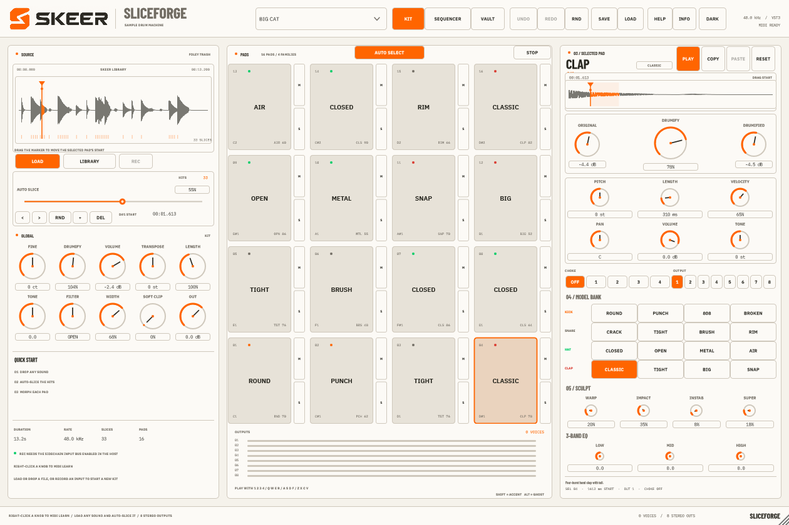
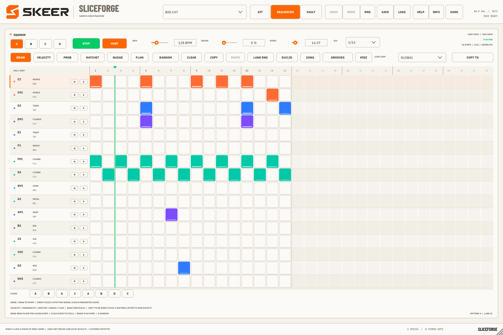
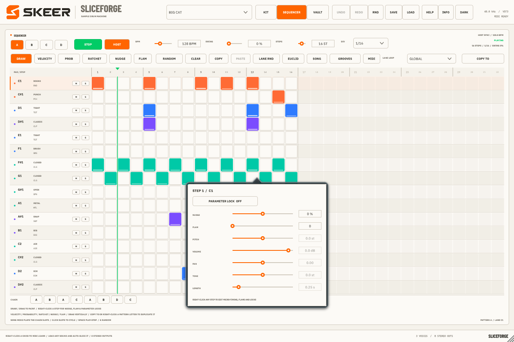
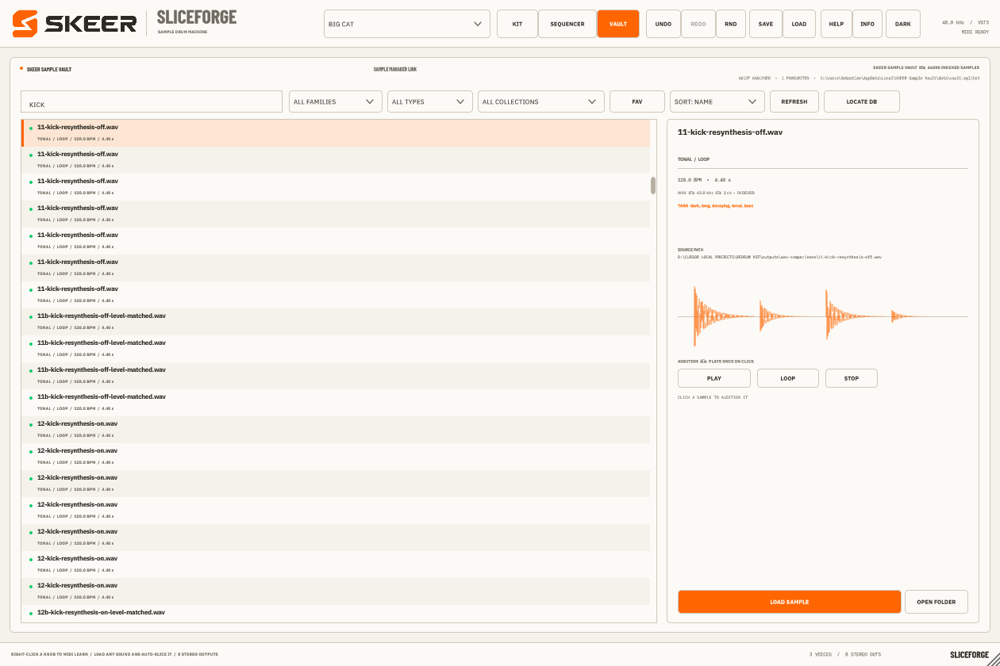
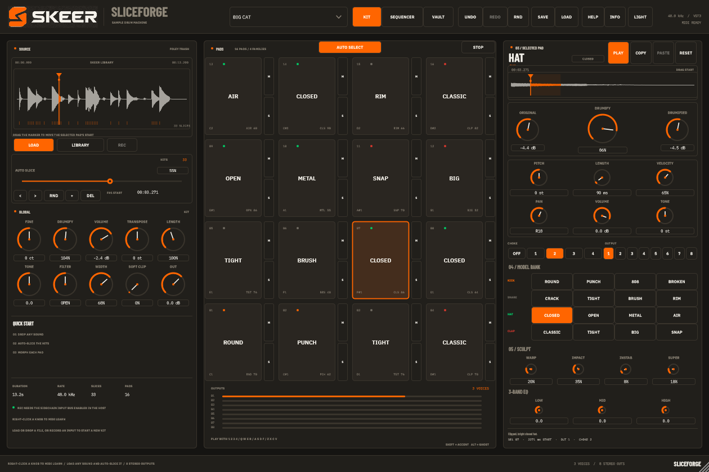
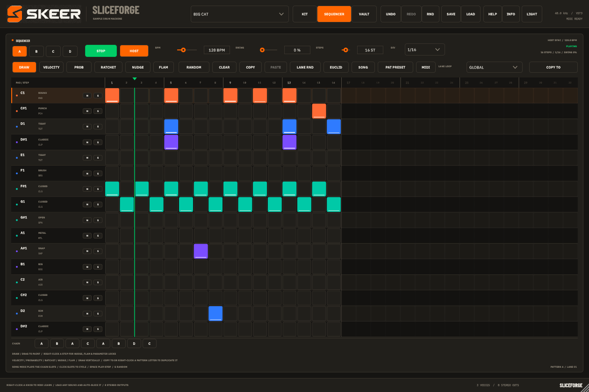
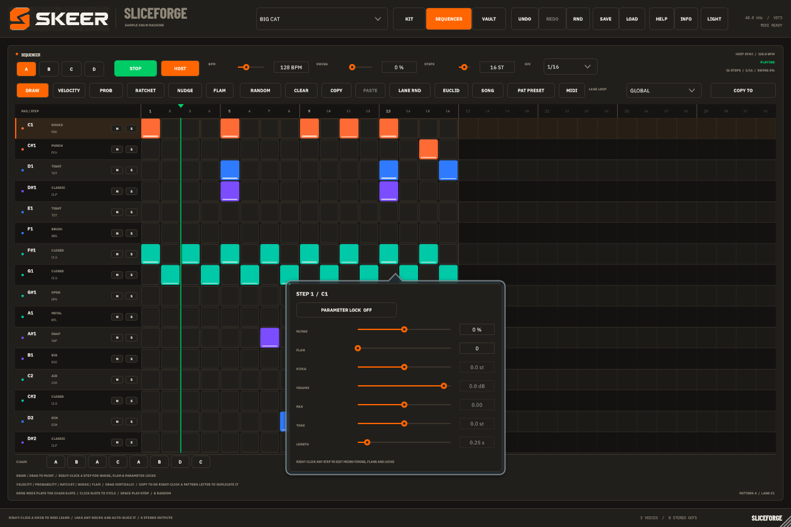
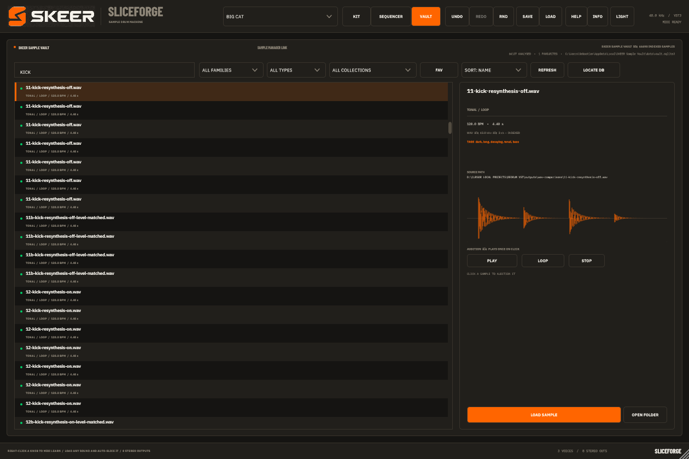

# SKEER SliceForge — Native VST3 / Standalone

**One sound. One drum kit.** The SKEER-branded native edition turns any recording into a
sixteen-pad instrument with sixteen drum models, per-pad morphing, eight stereo outputs and a
host-synced 32-step sequencer with pattern chaining, polymeter, parameter locks and MIDI export.



**SEQUENCER page**



**Step inspector — nudge, flams and parameter locks**



**SKEER Sample Vault page**



**Dark mode**









---

## Status

| | |
| --- | --- |
| Formats | VST3 instrument and standalone, x64 Windows |
| Framework | JUCE 8.0.4, C++20 |
| Vendor / bundle | SKEER / `com.skeer.sliceforge` |
| Host requirements | VST3 host with MIDI input and multi-output support. The sequencer also plays out over a MIDI event bus, which a host that has already scanned the plugin will only see after a reload. |
| Sample Vault link | Optional read-only SKEER Sample Vault index with click-to-audition playback (auto-detected) |
| Branding | SKEER logo, IBM Plex Sans / IBM Plex Mono, Barlow Condensed, SKEER palette |
| Theme | Light and dark SKEER skins, switched from the header and remembered per user |
| Build toolchain | Visual Studio 18 2026 / MSVC 14.51, CMake 3.22+ |
| Installed plugin | `%ProgramFiles%\Common Files\VST3\SliceForge.vst3` |
| Installed standalone | `%LOCALAPPDATA%\Programs\SliceForge\SliceForge.exe` |
| Launch folder | `..\launch\` — `SliceForge.exe`, `SliceForge.vst3`, `SliceForge-1.0.0-Windows-x64.zip`, `start.bat`, `start.ps1` |
| Test suite | 258 engine/state checks, editor layout snapshots, VST3 host load |

The plugin bundle is self-contained (factory audio and SKEER brand assets are embedded, no
external resource folder). The build is about **24 MB**. The VST3 session identity is preserved
from earlier SliceForge builds, so existing host sessions resolve to this SKEER-branded build; the
vendor display name is updated to SKEER. The interface supports a light studio theme and a dark
low-light theme.

---

## Build

Requirements:

- Windows 10/11 x64
- Visual Studio 18 2026 with the Desktop C++ workload
- CMake 3.22 or newer
- JUCE 8.0.4 in `native/external/JUCE` (a local source checkout; CMake clones it if missing)

From the repository root:

```powershell
cmake -S native -B native/build -G "Visual Studio 18 2026" -A x64
cmake --build native/build --config Release --target SliceForge_VST3 SliceForge_Standalone --parallel 2
cmake --build native/build --config Release --target launch
```

If you are already inside `native/`:

```powershell
cmake -S . -B build -G "Visual Studio 18 2026" -A x64
cmake --build build --config Release --target SliceForge_VST3 SliceForge_Standalone --parallel 2
cmake --build build --config Release --target launch
```

The `launch` target runs `package-launch.ps1`, which refreshes the repository-root `launch/` folder: it
re-copies `SliceForge.exe`, replaces the whole `SliceForge.vst3` bundle, and restamps the portable zip from
`native/Package/INSTALL.txt`, `native/Package/THIRD-PARTY-NOTICES.txt`, this README, the root `LICENSE`, the
two `launch/` start scripts and the `shots/` pictures this page links, then SHA-256-compares every member
against the file it claims. It is a separate target rather than a post-build step because Ableton holds a
loaded VST3's DLL open, and a build-time copy turns that lock into a failed compile hiding the result you
were trying to test. It also refuses to export while `SliceForge.exe` is running, instead of killing a
session that has no autosave.

`launch/` is the only place to look for something runnable:

```text
launch/SliceForge.exe                       standalone instrument
launch/SliceForge.vst3/                     VST3 bundle (Contents\x86_64-win\SliceForge.vst3)
launch/SliceForge-1.0.0-Windows-x64.zip     portable package: bundle, standalone, start.ps1,
                                            start.bat, LICENSE, THIRD-PARTY-NOTICES.txt, README
launch/start.bat                            install + standalone + browser in one click
launch/start.ps1                            the same three steps, with -DryRun / -InstallOnly
```

`COPY_PLUGIN_AFTER_BUILD` is deliberately disabled, so the build never writes to a system
VST3 folder by itself; installing is the explicit step below, or `start.bat`.

### Install

`launch\start.bat` does the install, the standalone and the browser edition together. The install
has one destination, `%ProgramFiles%\Common Files\VST3` — the system VST3 folder every host scans
by default — so it asks for elevation with a single UAC prompt covering the copy step only, never
the standalone or the dev server. It stages the bundle beside its target, SHA-256-compares the
staged module against `launch\`, swaps, then removes any `SliceForge.vst3` left in
`%USERPROFILE%\Documents\VST3` or `%LOCALAPPDATA%\Programs\Common\VST3`, because a second copy
only produces a duplicate browser entry and two builds that drift apart. A folder locked by an
open DAW is skipped rather than the host terminated, and a dev server already listening on 5173 is
reused. `launch\start.ps1 -DryRun` prints that plan without touching anything; `-InstallOnly` runs
step 1 alone and exits non-zero if the bundle did not land. The zip ships this same script at its own
root, where it finds no `src/`, installs anyway, and reports the browser edition as the checkout-only
feature it is instead of opening a page nothing is serving.

For the manual path, system-wide (the terminal must be elevated):

```powershell
Copy-Item "launch\SliceForge.vst3" "$env:ProgramFiles\Common Files\VST3\" -Recurse -Force
```

Only if a host genuinely will not scan the system folder, point it there instead of installing a
second copy beside it. `-Vst3Dir` exists for a machine whose scan root really is somewhere else.

Then rescan VST3 plugins in your DAW. The pre-rename `VRAC+.vst3` carried the same VST3 session
identity as SliceForge and was deleted from `%LOCALAPPDATA%\Programs\Common\VST3` on 2026-11-14; on
a machine that still has it, delete that copy once the new bundle scans, or the host lists two
entries for one plugin. If a previous build is still open in a DAW, close the DAW before replacing
a `.vst3` bundle and rescan after restarting it.

Standalone: run `launch\SliceForge.exe` directly, or install a copy:

```powershell
Copy-Item "launch\SliceForge.exe" "$env:LOCALAPPDATA\Programs\SliceForge\SliceForge.exe" -Force
```

---

## Test

```powershell
# from the repository root
ctest --test-dir native/build -C Release --output-on-failure
```

Individual tests:

```powershell
native\build\SliceForgeSmokeTest_artefacts\Release\SliceForgeSmokeTest.exe
native\build\SliceForgeLayoutTest_artefacts\Release\SliceForgeLayoutTest.exe
native\build\SliceForgeHostTest_artefacts\Release\SliceForgeHostTest.exe
```

The host test asks JUCE's VST3 hosting path to scan and instantiate the built bundle, asserts the
**350** parameters a host sees once the VST3 wrapper appends its own `Bypass` and `Program` on top of
the 348 that `createParameterLayout` builds (9 globals before the pad loop, 21 for each of 16 pads,
the 2 output-stage controls, then `seq.pattern` appended last), pins `seq.pattern` to the last layout
slot by index and step count, accepts an eight-stereo-output bus layout,
processes MIDI note 36, checks the output is finite and non-silent, and round-trips the plugin
state. The total is asserted exactly, not printed and compared against a round number. The bare
processor asserts the 348 half, so both numbers are gated, in two different programs.

The same hosted instance carries the MIDI output bus. `producesMidi()` is asserted there because on a
hosted plugin JUCE derives it from the event output buses in the binary, so the check reads what a
host would actually route to rather than what this source claims about itself; the audio layout is
still `1 in / 8 out`. It then runs 48 host-synced blocks and requires what comes back out to be a
clean stream - equal note-ons and note-offs, nothing but notes, every one on channel 10 within
C1–D#2, every one inside the block that produced it, with the audio still non-silent. What it
deliberately does not assert is *how many* notes: a hosted instance exposes no trigger oracle, so the
exact event list, down to the sample offset and the velocity byte, is gated in `SliceForgeSmokeTest`.

The layout test writes light and dark snapshots for the kit, sequencer, step inspector and
Sample Vault pages, opens the step inspector through the real UI path and verifies that no child
control falls outside its parent.

`SliceForgeSmokeTest` covers:

- factory source loading and slicing
- all sixteen models producing audio
- all eight stereo output buses
- pan, velocity response, mute and solo gating
- sample-accurate MIDI note triggering
- sequencer MIDI output: the exact event list on the host's output bus - one note-on/note-off pair per
  trigger at the sample offset the scheduler reported, `36 + pad` on channel 10, the exporter's
  `round (velocity x 127)` byte, a 32-sample gate, nothing else in the buffer, nothing when the host
  transport is stopped, and no pass-through of the notes played at the plugin
- exported-file parity: the printed MIDI clip is the pattern the sequencer played - the same swing on
  the odd steps, the same lane mutes and solos, the same probability draws for one named pass, the same
  note map. Proven two ways: one fixture is rendered through the scheduler and both paths are asked the
  same questions, and the resulting tick lists are pinned as literals, because a differential alone
  stays green when the code the two paths share goes wrong together
- factory presets and full state round-trip
- undo/redo and randomisation
- MIDI CC learn and learned-parameter movement
- sidechain-input recording and recording adoption
- custom-sample state round-trip
- internal step-sequencer playback, host-synced transport, sequencer state and sequence undo
- step nudge, flams, per-lane polymeter, song-mode chaining and parameter locks
- extended sequencer state round-trip, factory/user pattern presets and MIDI export
- pattern duplicate: copies steps, ratchets, flams, nudges and locks plus lane mute/solo/loop to
  another slot, replaces the destination, leaves the source and the selection alone, refuses
  self-copies and out-of-range indices, reaches the engine, and is undone in one step
- SKEER Sample Vault index query, plus the sample-loading path proven on files the test writes
  itself: a generated wav loads with the right channel and sample counts, and a 4 KB macOS
  AppleDouble sidecar named `.wav` is refused without replacing the loaded kit. Which of a real
  music library's listed files still resolve is reported, not asserted — it is a property of the
  machine, not of this plugin
- vault audition playback: one-shot end, loop wrap, source-rate resampling, the output
  limiter and the bus-1 mix that carries it to the host
- output stage: bypassed is bit-exact, nothing is attenuated below the knee, the tanh leaves
  the knee at slope 1, full scale lands on 0.844, the curve is monotonic and bounded, OUT GAIN
  runs after the clipper and is range-clamped, the ±0.999 ceiling gets the last word, and the
  whole stage is measured through the processor on a known signal
- output stage state loaded from a kit saved before it existed (params stripped from the
  host-state XML) restores bypassed and still plays
- randomizer, Euclidean, parseable MIDI file and CPU-headroom checks
- slice ends: on a fixture with four known onsets, each distinct slice gets `t[i+1] - t[i]` and the
  last gets the file tail; the gaps tile the material from the first onset to the end of the file; a
  take with fewer onsets than pads gets four distinct starts and four distinct lengths before any
  slice is reused, and the reuse then walks forward through the file instead of restarting at zero.
  Proven again through the processor on a wav the test writes itself: every pad's LENGTH times the
  global LENGTH equals its own gap, and sixteen pads carry four lengths rather than sixteen defaults.

Current result: **258/258 passed** - that is what `SliceForgeSmokeTest.exe` prints on the tree
this file describes, so re-run it rather than trusting the number here - with the engine using
between **4.4% and 5.8% of one core** across twelve separate runs while continuously
triggering pads at 48 kHz / 512 samples: they printed 4.52%, 4.56%, 4.86%, 5.04% and 5.75% on the
Step 24 bytes, 4.43% on the groove-bank build, and 4.45%, 5.32%, 5.26%, 4.64% and 4.36% on the five Step 25
scorer builds. Step 24
added eleven checks and each one runs once, so the tree before it printed 206/206, and the
**190/190** stamped here was already stale by sixteen - the import-ceiling commit restamped the
plan and missed this file, which is the sweep defect recorded in `docs/next-steps-plan.md` 8O. The
groove bank then moved the total again, and the arithmetic reconciles both stamps:
**217 − 2 + 22 = 237**, and the slicer scorer then made it **237 + 21 = 258** - eight checks on the
fixture state (directory, marks, baseline presence, readability, the tuning it was blessed under,
inventory parity, the band, and no capped row) plus eleven controls that score the scorer itself. The
twenty-one do not vary with how many takes are on disk, so adding the ninth rendered take does not
restamp this number. The two that went were the checks on the six-preset `PatternPreset` API that the
sixty-row bank replaced; the twenty-two come from nineteen check sites in `Tests/GrooveBankTest.cpp`,
which print one row per pattern slot in the slot-isolation arm (the same `^ *check (` census 8O uses). The
206-check run printed 4.38% and the 190/190 pair printed 6.91% and 4.51%; the machine load of each
run was not measured, so no spread is attributed to the checks, and the figure is reported rather
than asserted: real-time safety rests on the finite-and-in-ceiling checks, not on a wall-clock
bound that measured the machine rather than the engine.

### Auto-slicer ground truth

The detector used to be judged by ear, and the only number attached to it was a folklore correction
("pull the onset back 6 ms"). `Tests/SlicerScoreTest.cpp` is the ruler that replaces that opinion.

- **Material.** `fixtures/marks/<take>.marks.json` names a wav under `fixtures/` and lists its onset
  times in seconds, ascending. `schema` must read `sliceforge-slicer-marks/1`, `take` must equal the
  file name without `.marks.json`, and `markProvenance` must say where the truth came from - a marks
  file nobody can trace is refused, because a wrong reference is worse than no reference. The takes
  this repo intends to ship are rendered out of real kits in the DAW, so the reference is the MIDI
  clip's own note times: exact by construction, and free of any third-party recording. A marks file
  that claims `markProvenance: midi-note-times` is therefore checked against the clip itself - it
  must have a sibling `fixtures/marks-src/<take>.mid`, and the onsets read out of that file must
  agree with the JSON to a microsecond. A transcription nobody can re-derive from its source is not
  a measurement, so a mismatch or a missing `.mid` is a named red.
- **Scoring.** Each take runs through `detectSlices` at sensitivities 0.20 / 0.55 / 0.90 - the
  default plus both ends a customer can reach - and the onsets are matched one-to-one against the
  marks, closest pair first. The printed row carries `refN detN tp recall recall25 p fpmin medAbsMs
  maxAbsMs biasMs capped`, where `p` is the share of what the detector found that was real: a slice
  count alone can be raised by firing at nothing, and precision is what refuses to call that
  progress. 50 ms is the MIREX hit window; the 25 ms second recall exists because a
  50 ms window happily pays a detector that is consistently 40 ms late. A metric that is undefined
  prints `-` and lands in the JSON as `null`: a take with no reference onsets is never a 1.000, and
  a detector that stayed silent has no precision at all rather than a precision of 0.000.
- **The blessed table.** `fixtures/slicer-baseline.json` holds the numbers a given build produced,
  the six tuning constants they were produced with, and the tolerance bands. Every run re-scores and
  compares, so a **regression and an improvement both redden** - a detector that got better has also
  changed behaviour, and the shipped kit's feel changed with it. Re-blessing is explicit and never
  happens under ctest: `SliceForgeSmokeTest.exe --bless-slicer-baseline`. A bless refuses outright
  when a marks file did not load or when **no** sensitivity in the grid can cover a take, because a
  table that cannot pass is not a baseline - and the check next to it refuses the same inventory, so
  the rule cannot be stepped around by blessing. Being too dense for the *low* knob is not that:
  the budget at 0.20 is seventeen slices, so a thirty-event line prints `recall=0.567 capped=yes`
  there and carries its measurement on the 0.55 and 0.90 rows. Every capped row is named in the log,
  because a capped recall is the ceiling being read, not the detector missing.
- **Current state.** The committed corpus is tier 1: two synthetic takes (`synth-clean`, twelve hits
  at 500 ms; `synth-16ths`, thirty hits at 200 ms) and their six blessed rows. Both wavs and both
  marks files are re-derived byte for byte by `node fixtures/tools/synth-takes.cjs --check`, which is
  the synthetic answer to the same question `marks-src/*.mid` answers for a rendered take: the bytes
  have to be reproducible from something in the repo, not asserted by whoever made them.
  Tier 2 - the renders out of real kits - is still owed, and it is now a publishing decision rather
  than a chore: a marks file whose wav is missing is a named red, so committing a reference means
  committing that audio, and the audio of a commercial pack is derivative third-party material in a
  public repo. Either the wavs ship, or those takes stay out of the committed table.
  The twenty-one slicer checks in the total are eight fixture-state gates and thirteen controls;
  each of the ones that guard something was driven red on purpose, and the two new ones are reported
  in `docs/next-steps-plan.md` 8Q with the log they came from.
- **What the synthetic table already says.** On `synth-clean` the detector finds every click at all
  three sensitivities and the false-positive column reads 0.00 - but its signed bias is
  **-10.24 ms**, i.e. it reports the onset 10 ms *early*, and withdrawing the 6 ms correction moves
  the median absolute error from 10.24 ms to 4.24 ms. On clicks, in other words, the correction
  overshoots. The direction is now gated rather than argued: raising `kOnsetBiasSeconds` from 0.006
  to 0.020 moves `medAbsMs` on that take from 10.24 to 24.24 ms - the whole 14 ms, so the bias column
  is honest arithmetic - and drops `recall25` from 1.000 to 0.750, which is what the 25 ms window is
  for: at the committed -10 ms it still passes, and roughly 4 ms of drift is all it takes to fail.
  That is not yet a verdict on drums: a click has an instantaneous edge where a kit hit
  takes milliseconds to reach its peak, which is precisely the case the correction was written for.
  A second synthetic control says what clicks cannot: on a six-second 100-4000 Hz sine whose amplitude
  ramps up and never breaks - a swell, with no impulsive onset anywhere in it - the detector still
  returns **33 slice points** at the default sensitivity, 330 of them a minute, and the scorer prints
  that row on every run. Whether that is the tuning or the envelope shape, the rendered takes decide;
  the number is on the record either way.
  The number gets re-measured against the rendered takes, and only then does anything in
  `Engine/SlicerTuning.h` move.

---

## Using it

### Load a sound

- **LOAD** — WAV, AIFF, MP3, FLAC, OGG or M4A. You can also drag a supported audio file
  anywhere onto the plugin window.
- **LIBRARY** — six embedded factory worlds: Foley Trash, Night Kitchen, Body Talk, Iron Works,
  Short Circuit and Dust Loop.
- **REC** — records the optional sidechain input bus for up to five minutes of audio. The buffer is
  also capped at 256 MB, so at 192 kHz the take stops at 175 seconds instead; the button's tooltip
  states the limit that actually applies at the host's current sample rate. Enable the sidechain
  input bus in your host to use this. Stop recording and the take is adopted automatically as the
  new source.
- Waveform — drag the orange marker to set the selected pad's start position.
- **AUTO SLICE** — transient detection sensitivity. **HITS** shows the detected count. Re-slicing
  also writes each pad's **LENGTH** from the material: a pad plays from its onset to the onset that
  follows it, and the last slice runs to the end of the recording, so one take becomes sixteen
  separate hits instead of one long drone triggered from sixteen places. LENGTH stays a knob you can
  grab afterwards; moving AUTO SLICE again rewrites it, because the boundaries it came from moved.
- **< > RND** — step to the previous, next or a random detected hit.
- **+ / DEL** — add a slice at the current marker or delete the nearest slice. These edit the slice
  list only: a length already derived from the old boundaries is left alone, so grab LENGTH (or move
  AUTO SLICE) if you want the pads to follow the new ones.

### Theme

The **DARK / LIGHT** button in the header switches the complete SKEER interface between the warm
ivory studio skin and the low-light charcoal skin. The choice is stored under
`%APPDATA%\SliceForge\theme.txt` and is applied the next time the plugin editor opens.

### Play

- Click a pad; the click position sets velocity. **Shift** = accent, **Alt** = ghost.
- MIDI notes **C1–D#2** (MIDI 36–51).
- Computer keyboard: `1 2 3 4 / Q W E R / A S D F / Z X C V`.
- **SPACE** or **STOP** cuts all voices.
- **AUTO SELECT** follows keyboard and MIDI notes with the pad editor selection.

### Edit a pad

Each pad starts as a default kit role. The editor owns every pad parameter:

| Block | Parameters |
| --- | --- |
| Morph | Original level, Drumify blend, Drumified level |
| Main | Pitch, Length, Velocity amount, Pan, Volume, Tone Shift |
| Routing | Choke group 0–4, one of eight stereo outputs |
| Model Bank | 4 families × 4 models = 16 choices |
| Sculpt | Warp, Impact, Instability, Super |
| EQ | Low, Mid, High |
| Pad tools | Play, Copy, Paste, Reset |

Click a model to audition it immediately. **COPY / PASTE** move a pad's design to another pad
without changing its start position.

### Sequencer page

Use the **KIT / SEQUENCER / VAULT** tabs in the header. The sequencer runs alongside the drum
engine and follows host transport when available.

- **Patterns A–D** — four independent patterns with per-pattern lane mute/solo. Click a letter to
  edit and play it; right-click it to copy that pattern to another slot. Which one is live is a plugin
  parameter (**Active Pattern**, four choices, appended after every other control), so the host can
  automate it, learn it to a controller and recall it per position, and it travels with the saved
  session. The chips write that same parameter and mirror it back, so the UI and the host cannot
  disagree about what is playing.
- **Transport** — follows the host playhead and tempo; **PLAY** can preview on the internal
  clock when the host is stopped. **HOST** toggles host sync.
- **Length / division / swing** — 1–32 steps, 1/8, 1/8T, 1/16, 1/16T or 1/32, plus swing. One boundary is
  worth naming at the fine end: the plugin tells ordinary per-block jitter from a real transport jump with a
  tolerance of half a block, while a 1/32 step is a fixed size, so past about `block samples × BPM = 720 000`
  (4096 samples from roughly 176 BPM, 8192 from roughly 88, at 48 kHz) a jump of one whole step is read as
  continued playback.
  Nothing goes silent and edits still land — what does not happen is the hit-history reset, so a jump that
  lands on a step boundary can drop or repeat a single hit. Recorded as a known defect, with the gate that
  pins both sides of the seam, in the planning document (`docs/next-steps-plan.md` section 8C).
- **Colour-coded steps** — active steps use their drum-family colour: kick coral orange, snare
  electric blue, hats mint teal and clap violet. The playhead and transport state use the green
  playback colour.
- **Draw** — click or drag to paint steps.
- **Velocity / Probability / Ratchet** — select a lane, choose an edit mode and drag vertically.
  Active steps keep their full family colour, with velocity as a slim bottom bar, probability as
  a dot and ratchets as an `x2`–`x4` count.
- **Nudge** — use the NUDGE mode and drag vertically for ±50% of a step of micro-timing, or
  right-click any step and use the inspector.
- **Flams** — use FLAM mode or the inspector for up to two grace hits before a step.
- **Parameter locks** — right-click a step, enable **PARAMETER LOCK**, and lock pitch, volume,
  pan, tone and length for that individual hit.
- **Song mode / chain** — enable **SONG** and click the eight chain slots to cycle them through
  patterns A–D. Playback advances one slot per pattern-length.
- **Polymeter** — the **LANE LOOP** menu sets the selected lane to GLOBAL or its own loop length
  (1–32). Grid cells repeat visually when a lane runs shorter than the pattern.
- **Lane M/S** — mute or solo one sequencer row without changing the kit's pad mute/solo.
- **Random** — light/medium/busy grooves, mutate, humanise, accent downbeats, shift left/right,
  randomise the selected lane, or generate 3/5/7-pulse Euclidean rhythms.
- **Grooves** — the **GROOVES** menu is the preset library: sixty named patterns in twenty genres, three
  variations each (HOUSE, TECHNO, TRAP, BOOM BAP, DRUM & BASS, UK GARAGE, AFRO, DANCEHALL, BREAKS,
  ELECTRO, REGGAE & DUB, FUNK & SOUL, LO-FI, HARD & CLUB, DISCO, TRIP HOP, POP, ROCK, EBM & INDUSTRIAL,
  LATIN). One submenu per genre, the row you applied stays ticked, and **Next <GENRE> variation** steps
  through the three without opening the menu again. A groove writes its pattern into the slot you are
  editing *and* takes the grid with it — two bars (32 steps), plus that genre's tempo, division and swing
  — because the scheduler wraps on the length, so a second bar written behind a 16-step grid is data
  nobody hears. It never changes what your pads sound like: **Match <GENRE> sounds** is a separate,
  opt-in item that sets the named pads' models and leaves every other pad alone. Saving and loading
  `.vracpattern` files live on the same menu.
- **Copy / Paste / Clear** — clipboard pattern-level operations. **COPY** takes the pattern you are
  editing and **PASTE** writes it over whichever pattern you switch to next; **CLEAR** empties the
  current one.
- **Copy to** — **COPY TO**, or a right-click on any pattern letter, duplicates one pattern into
  another slot in a single step, without going through the clipboard. The destination is replaced
  whole: steps, velocities, probabilities, ratchets, nudges, flams, parameter locks, lane mutes and
  solos, and lane loop lengths. The menu names the source and marks any destination that already
  holds a groove, so an overwrite is never a surprise. Your selection does not move, and one undo
  step brings back the pattern that was replaced. The song chain stores pattern *numbers*, so a
  chain slot pointing at the destination plays the copy from then on.
- **MIDI** — export a Standard MIDI File of the current pattern or song chain, or start a MIDI
  file drag into a host that accepts external file drops. The file is the groove you heard: swing,
  lane mutes and solos, probability dropouts, flams, ratchets and nudges are baked into it, and it uses
  the same `36 + pad` note map the plugin's own live MIDI out uses. One printed file is one *pass* — the
  plugin re-rolls its probability lanes every time the transport restarts, so the file names the pass it
  is a snapshot of inside itself, and looping that clip in your host replays that same set of dropouts.
- **Live MIDI out** — while the sequencer plays, every hit it schedules is also written to the
  plugin's own MIDI output bus as `36 + pad` on channel 10, at the sample offset the engine hears, so a
  drum rack or a second instrument can play along with the kit. There is no switch for it: the notes
  are the sequencer's own, and the grid's lane M/S is what takes them off the wire.
- **Keyboard** — `SPACE` starts/stops internal preview; `G` generates a random groove.

The sequence, chain, nudge/flams and parameter locks are saved with the host state and
`.vracpreset` files.

### SKEER Sample Vault page

SliceForge can read the **SKEER Sample Vault** index directly. It opens the vault's local SQLite
index read-only, so browsing and filtering do not decode or analyse every file again, and no
files are modified.

- **Automatic connection** — finds the installed vault database, the installer registry, a
  saved custom path, or a development checkout beside SliceForge. If the index is elsewhere, use
  **LOCATE DB** once; the path is remembered.
- **Browse** — search filenames, folders and indexed tags; filter by family, type, collection
  or favourites; sort by name, recency, duration or BPM.
- **Indexed detail** — family/type/BPM/key, duration, sample rate, channels, tags, notes,
  source path and the waveform generated by the vault's analysis.
- **Audition** — clicking a row decodes that file on a worker thread and plays it once on
  output bus 1, with a playhead over the real waveform. **PLAY** hears the same decode again
  without touching disk, **LOOP** repeats it until you stop it, and **STOP** cuts it. The
  audition is mixed after the master chain and limited, so it never pushes a playing kit
  above full scale. In a VST3 the host has to be processing audio for it to be heard — with
  the transport stopped and monitoring off the panel says so instead of pretending to play.
- **Load** — select a sample and press **LOAD SAMPLE** or double-click it. SliceForge loads the
  original source file into the current kit and returns to the KIT page. Samples that are
  still queued for vault analysis are shown and can still be loaded.
- **Refresh** — rereads the index after the vault has analysed more samples or imported new
  folders.

The vault remains the owner of its database; SliceForge only reads it.

### Global, presets and MIDI

- **GLOBAL** — fine tune, global Drumify macro, master volume, transpose, length scale, tone,
  DJ-style filter, stereo width, plus the output stage: **SOFT CLIP** and **OUT** (see
  *Outputs*).
- **Preset menu** — six factory kits: BIG CAT, NIGHT KITCHEN, BODY TALK, IRON WORKS, SHORT
  CIRCUIT, DUST LOOP.
- **SAVE / LOAD** — `.vracpreset` files stored under `%APPDATA%\SliceForge\Presets` (since the
  rename; earlier builds used `%APPDATA%\VRACPlus`). The host
  session also stores the complete kit, slice map, MIDI mappings and — for user/recorded
  samples — the sample PCM itself.
- **UNDO / REDO** — 50 steps of parameter, slice, pad-start and selection changes. Source changes
  and factory presets intentionally reset the undo history.
- **MIDI learn** — right-click any knob, choose **MIDI Learn**, then move a MIDI CC. CC mappings
  are saved with the plugin state. Use the same menu to cancel learn.

### Outputs

The plugin exposes eight stereo output buses plus an optional stereo sidechain input. In a DAW,
output 1 is the main bus and outputs 2–8 can be enabled for per-pad routing. If the host only
enables the main output, inactive buses are folded into output 1 with a soft clip.

Every enabled bus then passes through the same output stage, in this order:

1. **SOFT CLIP** (`global.clip`, 0–100 %) — a tanh saturator with a knee that starts at 0.999 and
   drops to 0.349 as the control opens. At 0 % the stage is bit-exact: nothing is added, nothing is
   attenuated. Above the knee the curve leaves at slope 1 and settles just under full scale, so a
   hot kit gets a rounded ceiling instead of a hard fold.
2. **OUT** (`global.out`, −24 to +12 dB) — plain output trim, applied *after* the clipper. It is a
   visible knob on purpose: the clipper never quietly makes up its own gain, so turning it up is
   always a decision you can see and undo.
3. **Ceiling** — a hard clamp at ±0.999 that always runs last, so no combination of the two knobs
   or a stacked host gain can hand the host a sample outside [−1, 1]. The folded main bus could
   previously reach about 1.25; it can no longer.

---

## Architecture

```text
Source/
  Params.*              parameter IDs, defaults, factory model metadata
  Presets.*             six factory kits
  GrooveBank.cpp        the factory groove bank: 20 genres x 3 named variations, step masks,
                        per-genre voicings
  Sequencer.*           4-pattern/32-step model, song chain, micro-timing, flams,
                        parameter locks, per-lane polymeter, pattern duplicate,
                        groove parsing and application, and MIDI export
  VaultLibrary.*        read-only SKEER Sample Vault SQLite index discovery and queries
  PluginProcessor.*     APVTS, sample/slice state, 32-voice engine, 8-bus host output,
                        sequencer scheduling, recording, MIDI learn, undo/redo, state,
                        vault audition mix on bus 1, per-bus output stage,
                        sequencer MIDI out on the host's event bus
  PluginEditor.*        resizable editor at base 1260×840, scaled via transform,
                        light/dark theme switching
  Engine/
    SampleData.*        embedded/user sample loading, 24-bit WAV helpers
    PreviewPlayer.*     vault audition: atomic hand-off, linear resample, loop wrap, limiter
    Slicer.*            RMS-flux transient detector
    Dsp.h               RBJ biquads, master filter/tone/width chain, OutputStage soft clipper
    VoiceEngine.*       32-voice fixed pool, 16 model synthesizers, stereo bus rendering
  UI/
    Theme / LookAndFeel / Controls / WaveformDisplay / PadGrid / PadsPanel /
    SourcePanel / PadEditorPanel / HeaderBar / FooterBar / SequencerGrid / SequencerPanel /
    VaultPanel
Tests/
  SmokeTest.cpp         the engine/state suite (258 checks in total, printed at the end)
  GrooveBankTest.*      the bank's structural and audible checks, run by SmokeTest (22 of the 258)
  SlicerScoreTest.*     the slicer scorer, its baseline gate and its controls (21 of the 258)
  LayoutTest.cpp        editor bounds + PNG snapshots
  HostTest.cpp          scans and loads the built VST3 through JUCE's host path
```

- 32 fixed voices; no audio-thread allocation or locking.
- A shared sample pointer is published atomically, so a source swap never interrupts a sounding
  voice.
- MIDI note events split the block at their sample position, so timing is sample-accurate.
- The sequencer uses per-pad step history, so micro-timed events can cross audio block boundaries
  without being lost or doubled.
- The sequencer's triggers reach the host twice over: as audio from the engine, and as one
  note-on/note-off pair on the MIDI event bus at the same sample offset, `36 + pad` on channel 10. The
  pair opens and closes inside the block that scheduled it, so no note can be stranded by a stopped
  transport or a pattern change, and the only memory involved is the host's own buffer growing to fit
  an event-heavy block.
- UI triggers use a lock-free FIFO; MIDI CC learn uses a lock-free FIFO and an AsyncUpdater.
- Audio is folded to the main output only when the host does not expose the aux buses.
- The project builds with the static MSVC runtime.

---

## Limitations / notes

- VST3 and standalone only; no AU/AAX.
- Recording uses the optional sidechain input bus. If a host does not expose it, load a file
  instead.
- Multi-output routing requires the host to enable the additional output buses.
- The MIDI output bus is part of what a host reads when it scans the plugin, so a host that already
  loaded SliceForge has to reload it (or rescan the folder) before the bus appears. Sessions saved
  against an earlier build still load; they just will not see the new bus until the plugin is
  re-instantiated.
- The MIDI output follows the sequencer, not the mixer: a pad muted with its **Mute** button still
  plays its notes out over MIDI, because the mute is an engine state and the step was genuinely
  scheduled. Only the pattern's own lane M/S and the step switch take a note off the wire.
- Native preset files include custom-sample PCM; they can be several MB for long recordings.
- The native build does not include the browser edition's WAV/ZIP export; render or bounce from
  the DAW instead.
- MIDI pattern export writes notes, velocity, nudge, flams and ratchets. Probability rolls and
  parameter locks are performance features and are not encoded in the MIDI file.
- Song mode uses eight chain slots, one pattern-length each. Parameter locks currently cover
  pitch, volume, pan, tone and length.
- The Sample Vault link is read-only and uses the Windows SQLite engine. A queued or
  unanalysed vault entry can still be browsed and loaded, but only analysed entries have
  metadata, tags and indexed waveform previews. Loading a sample into SliceForge still performs the
  instrument's own slice detection on that one sample.
- The factory library is original procedural material generated for this project. The real
  VRAC+ library was produced with foley artist Olivier Thys; this project is a tribute with its
  own recipes.

## Credits / disclaimer

SKEER wordmark and brand direction are used for the SKEER instrument line. IBM Plex Sans, IBM Plex Mono and
Barlow Condensed are bundled under the SIL Open Font License, whose full text is in `THIRD-PARTY-NOTICES.txt`
— the name that file has in this portable package, where it sits beside this README, and the same text the
repository keeps at `native/Package/THIRD-PARTY-NOTICES.txt`. JUCE 8.0.4 is used under the AGPLv3 leg of its
dual licence, and that file names every component this build compiles in, with the census that drew the boundary.

SliceForge is an independent interpretation inspired by VRAC+ by Beatsurfing. Not affiliated with or
endorsed by Beatsurfing / Druw Audio. The factory sound library is original procedural material
generated for this project. The browser edition lives at the repository root and is documented
in the root `README.md`.
